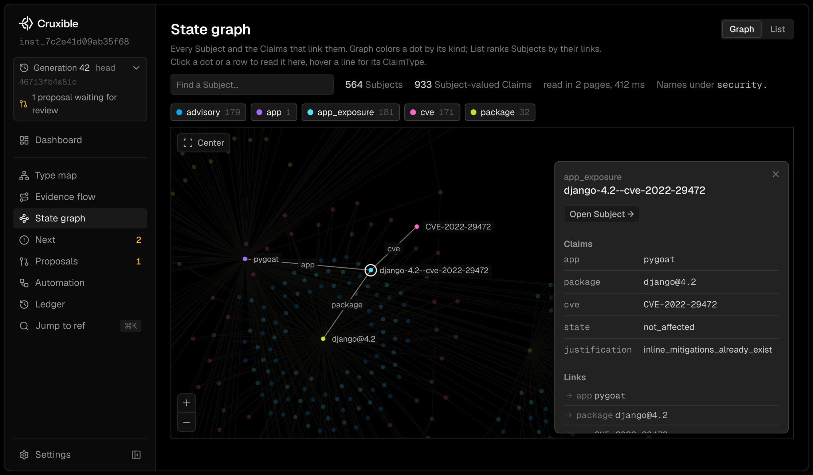

<p align="center">
  <a href="https://cruxible.ai">
    <picture>
      <source media="(prefers-color-scheme: dark)" srcset="https://raw.githubusercontent.com/cruxible-ai/cruxible/main/assets/brand/cruxible-wordmark-white.svg">
      
    </picture>
  </a>
</p>

<p align="center">
  <a href="https://cruxible.ai">Website</a> |
  <a href="https://docs.cruxible.ai">Docs</a> |
  <a href="https://cruxible.ai/kits">Kits</a> |
  <a href="https://cruxible.ai/skills">Skills</a> |
  <a href="https://github.com/cruxible-ai/cruxible/releases">Releases</a>
</p>

# Cruxible

**A knowledge layer worth building.**

Cruxible aligns organizations, agent swarms, and future runs on shared, grounded
state by letting your agents treat domain knowledge like what they're trained
for: typed, Git-versioned, reviewable code. Your code, docs, and databases
remain the sources of truth: typed state holds the structured claims and
decisions pointing to them, reasoning stays in plain Markdown to read and grep,
and deterministic Python pipelines seed and refresh observations from reality
(APIs, analyzers, experiments, or custom models). Reviewed judgments stay pinned
to their evidence and live observations, retrieved minimally and valid until the
underlying facts or premises move.

<p align="center">
  <a href="https://cruxible.ai">
    
  </a>
</p>

It lets you:

- **Separate fast observations from slower judgments:** deterministic Python
  pipelines run on a fast path (keeping high-rate telemetry and run logs in an
  exhaust journal outside the ledger) to pull live facts from APIs, sensors,
  experiments, scanners, or custom models at zero LLM tokens, marking failed
  sources `unknown`.
- **Investigate once, align teams and swarms:** people and parallel agents
  propose narrow typed judgments pinned to exact evidence (no silent clobbers,
  no two-page essays to audit), so future runs retrieve settled truth minimally
  instead of rediscovering it from company prose.
- **Falsifiable and valid until inputs move:** when a cited file, live
  observation, or upstream premise is overturned by new data or a smarter model,
  only the judgments and dependent work resting on it re-open; everything else
  stays current.

No LLM runs inside Cruxible. Everything runs locally on Linux (x86-64) and
macOS (Apple silicon) with Python 3.11+ (Windows via WSL2), backed by a signed
Git ledger with per-field history.

**Try it on your own repo in ~60 seconds:** install Cruxible and the core skills
below, ask your coding agent to run `/survey`, and open `cruxible console` to
inspect a live, cited State graph of your repository's real decisions and
dependencies.

## Install and start

Requirements: Python 3.11+ and Git. Linux x86-64 and macOS on Apple silicon; on
Windows, use WSL2.

```bash
uv tool install cruxible             # or: pip install cruxible
cd your-project
cruxible init --principal-id owner
npx skills add cruxible-ai/cruxible  # then ask your agent to run /survey
cruxible console                     # inspect the live State graph in your browser
```

`cruxible init` starts a local daemon if none is running and creates this
project's instance. Prefer a ready-made starter vocabulary instead of `/survey`?
Run `cruxible kit add project-state --commit` (or `security`, `iot-fleet`), then
`cruxible orient && cruxible next`.

For two-principal **cosign** (where a second agent or person must approve every
proposal before it counts), initialize with independent approval:

```bash
cruxible init --principal-id owner --require-independent-approval
```

Follow the [Quickstart](docs/quickstart.md) to watch drift detection and
dependency cascades catch a live edit.

## See it work: vulnerability triage across five sources

Deciding whether a security alert actually affects an application means
combining your dependency list, three public vulnerability feeds (advisories,
known active exploits, and exploit likelihood), your own source code, and a
reviewer's sign-off. No single scanner owns the whole picture, and Markdown
notes drift as soon as a package or file changes.

With Cruxible's **security kit** on a Django app with 32 packages:

### 1. Pull external facts and surface what needs judgment

One automated pipeline reads the app's dependency list and pulls those three
feeds (OSV advisories, CISA's known-exploited catalog, and EPSS exploit
scores). Because pulling declared feeds is mechanical, they settle
automatically under explicit, expiring mandates, recording both matches and
verified absences (only marking "not actively exploited" when the full catalog
loaded). Out of 181 findings, only the 7 high-risk unjudged exposures land in
the inbox:

```text
$ cruxible runbook run security.start
   1  Line:security.sbom-import.app              written 32 (settled 32, proposed 0)
   2  Line:security.osv-query                    written 181 (settled 181, proposed 0)
   3  Line:security.kev-triage                   written 181 (settled 181, proposed 0)
   4  Line:security.epss-triage                  written 543 (settled 543, proposed 0)
   5  Line:security.exposure-attention.unjudged  inbox 7 new
```

### 2. Record a judgment citing exact code; review and sign it

Judging whether a vulnerability is actually reachable is the agent's job. It
inspects the repository, finds that the app lists `PyYAML 5.1` while the only
`yaml.load` call lives in a separate container, and proposes a `not_affected`
judgment citing that exact line:

```python
from cruxible_client import Cruxible, FileEvidence

with Cruxible.connect() as cx:
    w = cx.world()  # typed against .cruxible/world.pyi
    w.security.app_exposure.define(
        occurrence="security.occurrence/sbom.cdx.json--pkg-pypi-pyyaml-5.1",
        vulnerability="security.vulnerability/cve-2020-14343",
    ).set(
        justification="vulnerable_code_not_in_execute_path",
        evidence=FileEvidence(
            file="dockerized_labs/a9_uckv_lab/app.py#data = yaml.load(file.stream, Loader=yaml.Loader)"
        ),
    ).write(
        because=(
            "CVE-2020-14343: the only yaml.load in the repo is in dockerized_labs/a9_uckv_lab, "
            "a separate container with its own requirements; the Django app never imports yaml."
        ),
        accept="never",  # -> proposal; a second principal reviews and signs it
    )
```

A second agent (or human) acting as `reviewer` sees the domain guidance, the
proposed verdict, and the cited line before signing off:

```text
$ CRUXIBLE_PRINCIPAL_ID=reviewer cruxible proposal review 54251d28...
Guidance: document:security.guidance.dependency (Judging a dependency exposure)
  set ...pyyaml-5.1--cve-2020-14343 justification: vulnerable_code_not_in_execute_path  [verdict supported]
    cites dockerized_labs/a9_uckv_lab/app.py
      | data = yaml.load(file.stream, Loader=yaml.Loader)
```

### 3. When inputs move, re-check only what changed

When `PyYAML` is upgraded and the pipeline runs again, only the changed
package and advisory are written; every other package and judgment is
re-checked and left alone:

```text
$ cruxible runbook run security.start
   1  Line:security.sbom-import.app              written 1; unchanged 31; retired 1
   2  Line:security.osv-query                    written 1; unchanged 178
   3  Line:security.kev-triage                   written 0; unchanged 179
   4  Line:security.epss-triage                  written 0; unchanged 537
```

If someone instead edits the cited line in `dockerized_labs/a9_uckv_lab/app.py`,
`cruxible next` brings that specific judgment back as `citation_drifted` so a
later session re-verifies it instead of trusting a stale waiver. Every field
keeps its signed history and provenance:

```text
$ cruxible get security.app_exposure/sbom.cdx.json--pkg-pypi-pyyaml-5.1--cve-2020-14343 --detail history
justification
  proposed 2026-11-18 by owner, approved by reviewer  stated  vulnerable_code_not_in_execute_path
      reason: CVE-2020-14343: the only yaml.load in the repo is in dockerized_labs/a9_uckv_lab, a
      separate container with its own requirements; the Django app this SBOM describes never imports yaml.
```

See the full [Security walkthrough](docs/security-walkthrough.md) to run this
on your own repository. Security is one domain: see also the
[Project state walkthrough](docs/project-state-walkthrough.md) (coding-agent
session handoffs, doc citations, and selective dependency cascades) and the
[IoT fleet walkthrough](docs/iot-fleet-walkthrough.md) (deterministic EWMA
telemetry at zero LLM tokens). `cruxible console` opens a read-only view of any
instance in your browser.

## Why Cruxible

Autonomous, multi-session work breaks down when knowledge lives only in prose
or gets locked inside single-purpose tools:

- **Text alone and facts alone both lose; pairing them wins.** In
  [LongMemEval](https://arxiv.org/abs/2410.10813) (ICLR 2025), reducing memory
  to extracted facts lowered accuracy, while indexing structured facts
  alongside full text beat text alone; in
  [MemoryAgentBench](https://arxiv.org/abs/2507.05257), note-based systems
  repeatedly failed to let newer statements override older contradicting ones.
  Cruxible marries the two: long-form reasoning stays in plain Markdown for
  reading and grep, while typed claims hold the single current truth, answer
  exact set queries (`NOT EXISTS`, counts), and wake up when cited passages or
  upstream claims move.
- **A plain database still needs this layer built around it.** SQLite or
  Postgres stores rows cleanly (Cruxible itself indexes into SQLite), but for
  agent-maintained knowledge you still end up building citations, freshness,
  *verified none* vs. *unknown*, signed review, and versioned history on top.
  Cruxible gives you that layer out of the box.
- **Single-purpose tools do not own cross-source judgments.** Your repos,
  databases, and SaaS tools remain the sources of truth for their own records.
  Cruxible sits at the judgment layer across them, joining external feeds, local
  files, and team decisions without copying whole tables or locking your
  decision history inside one vendor.

Cruxible gives agents and teams:

- **The structure coding agents naturally want.** Agents can run exact typed
  queries, grep plain Markdown and readable local YAML mirrors in
  `.cruxible/floor/`, and write Python to batch updates or turn any repeatable
  retrieval, analysis, simulation, or model into a deterministic pipeline.
- **Freshness, cascades, and completeness, not silent drift.** Pipelines
  re-check facts on a trigger or schedule, freshness windows flag expired
  evidence, drift checks catch edited citations and wake dependent claims when
  upstream decisions change, and Cruxible distinguishes **found**, verified
  **none** (from a complete source read), and **unknown**, so a failed lookup
  never reads as "safe."
- **Graduated automation (`observe` → `propose` → `settle`).** Pipelines start
  by observing or proposing for review, and only settle named fields on their
  own under explicit, scoped, expiring mandates.
- **Governed, verifiable history.** Every change is a proposal checked
  deterministically under your approval policy, recorded in a signed Git ledger
  where any earlier generation can be read back as it stood.
- **Stable subassemblies across sessions.** Like Hora in Herbert Simon's
  [watchmakers](https://faculty.sites.iastate.edu/tesfatsi/archive/tesfatsi/ArchitectureOfComplexity.HSimon1962.pdf#page=5),
  agents build reusable, verified intermediate facts and repeatable pipelines
  instead of re-deriving context from scratch every time a window resets.

## Use it from your agent

One local daemon owns accepted state (`cruxible init` starts it automatically,
or run `cruxible server start` explicitly); agents interact with it however
they work best:

- **Python SDK (`cruxible python`):** typed handles from `.cruxible/world.pyi`,
  atomic write batches, and zero-setup execution from any repository
  ([SDK reference](packages/cruxible-client/README.md)).
- **CLI & local files:** `orient`, `query`, `get`, `next`, `set`, `write`, and
  `authoring` (with `--json`), plus readable YAML mirrors in `.cruxible/floor/`
  to grep alongside your Markdown docs ([CLI reference](docs/cli-reference.md)).
- **MCP:** `uvx cruxible mcp` for agents without a shell or code environment
  ([MCP tools](docs/mcp-tools.md)).

Add the five core skills across Claude Code, Codex, Cursor, and 75+ agents with
`npx skills add cruxible-ai/cruxible` (`survey`, `adopt-kit`, `create-state`,
`automate-state`, `review-state`), or kit skills with
`npx skills add cruxible-ai/cruxible-kits`. See [For AI agents](docs/for-ai-agents.md)
(optional plugin bundles live in [plugins/README.md](plugins/README.md)).

## How it works

- **Claims, Subjects, and Evidence.** Each fact is a Claim about a Subject
  under a ClaimType that declares its value type, cardinality, freshness, and
  admitted evidence: the author's own words, a cited passage in a workspace
  file, or a retained Capture under a declared contract.
  ([Evidence and admission](docs/evidence-and-admission.md),
  [Asking questions](docs/asking-questions.md))
- **Proposals and signed history.** Every mutation is a proposal checked
  deterministically and accepted under your approval policy with signed
  approvals into a Git ledger. High-rate run telemetry stays in operational
  exhaust outside the ledger.
  ([Review and governance](docs/review-and-governance.md),
  [Architecture](docs/architecture.md))
- **Procedures, Lines, and Triggers.** A Procedure is a reviewed, replayable
  graph of steps that reads accepted state, invokes pinned provider builds
  through typed capability slots, extracts typed records, and proposes,
  settles, or posts to the inbox. Because computation lives in pinned provider
  packages (anything from API fetches and SQL queries to static analyzers or
  custom ML models), teams and agents can push any repeatable retrieval or
  derivation into a governed pipeline. A Line binds a Procedure's inputs,
  budgets, and authority ceiling to Triggers (cron, cadence, capture landing,
  or accepted changes).
  ([Lines and automation](docs/lines-and-automation.md))
- **Kits.** A domain (its vocabulary, queries, guidance documents, Procedures,
  skills, and bundled providers) travels between instances as a kit, installed and
  upgraded as reviewed changes. ([Kits](docs/kits.md))
- **Credentials and principals.** A credential is a daemon bearer token with a
  permission tier (`read_only`, `governed_write`, `graph_write`, `admin`); a
  principal is a signing key that attributes acts and signs approvals.
  ([Who acts](docs/concepts.md#who-acts))

The [concepts guide](docs/concepts.md) walks through all of these in order.

## Documentation

Pick a starting point based on what you're trying to do (or browse the
[full index](docs/index.md)):

| If you want to… | Start here |
|---|---|
| **Try Cruxible on a real repo in minutes** | [Quickstart](docs/quickstart.md), plus walkthroughs for [Project state](docs/project-state-walkthrough.md), [Security](docs/security-walkthrough.md), and [IoT fleet](docs/iot-fleet-walkthrough.md) |
| **Understand the mental model and vocabulary** | [Concepts](docs/concepts.md), [Architecture](docs/architecture.md) |
| **Connect an AI agent (MCP, CLI, SDK, skills)** | [For AI agents](docs/for-ai-agents.md), [Skills](skills/) (`npx skills add cruxible-ai/cruxible`) |
| **Decide what to model as state vs. prose** | [Building team knowledge](docs/building-team-knowledge.md) (modeling habits and *Mistakes we made ourselves*) |
| **Keep Markdown docs in sync with live state** | [Documents and notes](docs/documents-and-notes.md) (atomic note+Claim writes, review guidance, and self-updating **projection blocks**) |
| **Require stronger evidence or track predictions** | [Evidence and admission](docs/evidence-and-admission.md) (admission rules, freshness, attestations, and **predictions**) |
| **Query across relations or time-travel history** | [Asking questions](docs/asking-questions.md) (`--follow`, saved queries, `--at`, and grepping `.cruxible/floor/`) |
| **Work drift queues and decide what to verify** | [Keeping knowledge current](docs/keeping-knowledge-current.md) (`next` repairs, duplicates, `audit` ranking, and none vs. unknown) |
| **Build scheduled pipelines or custom providers** | [Lines and automation](docs/lines-and-automation.md) (Procedures, pinned providers, inbox posts, and earning `settle` mandates) |
| **Lock down review, cosign, or propose-only agents** | [Review and governance](docs/review-and-governance.md) (approval policies, `governed_write` agents, and trust boundaries) |
| **Evolve schemas or package reusable domains** | [Evolving your vocabulary](docs/evolving-your-vocabulary.md) (migrating Claims without losing history), [Kits](docs/kits.md) |

**Reference & operations:** [CLI reference](docs/cli-reference.md) |
[MCP tools](docs/mcp-tools.md) |
[Python SDK](packages/cruxible-client/README.md) |
[Isolated deployment](docs/isolated-deployment.md) |
[Upgrading](docs/upgrading.md) |
[Data and network](docs/data-and-network.md) |
[Hosted runtime image](docs/hosted-runtime-image.md)

## Develop

```bash
git clone https://github.com/cruxible-ai/cruxible
cd cruxible
uv sync --all-packages --all-extras
uv run pytest -n auto --dist loadfile
```

See [CONTRIBUTING.md](CONTRIBUTING.md) for provider-runtime tests, lint,
format, and type checks.

Apache-2.0 licensed.

<!-- mcp-name: io.github.cruxible-ai/cruxible-core -->
