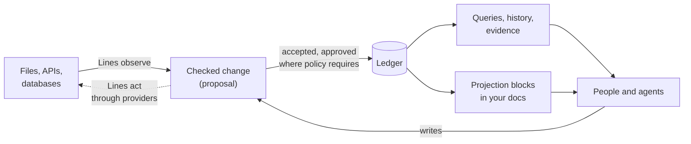
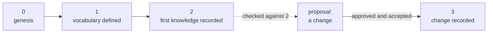
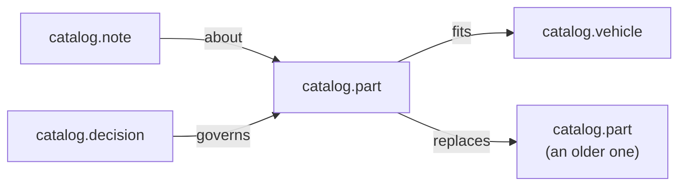
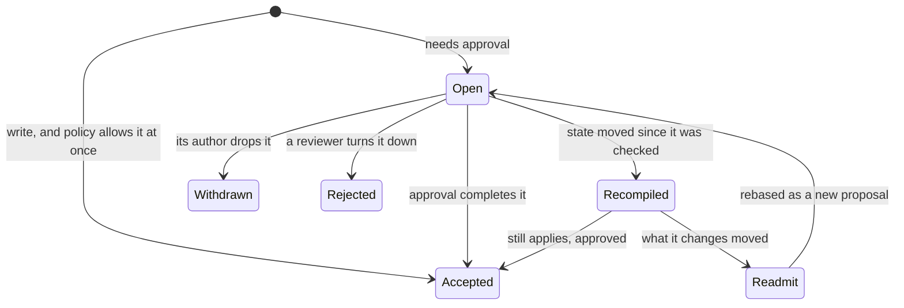
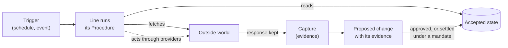

# Concepts

This page explains the ideas Cruxible is built on: what each one is, and what
it gives you. The [Quickstart](quickstart.md) and the [Security
walkthrough](security-walkthrough.md) show them in use; the [CLI
reference](cli-reference.md) and [MCP tools](mcp-tools.md) list every
operation.

## What Cruxible is for

Cruxible keeps what a team of people and agents believes about its world as
**hard state**: typed values, each with the reason and the evidence behind it,
changed only through checked changes, with a full record of what was believed,
when, and why.

Without it, that knowledge lives in documents, tickets, chat threads and
agents' context windows, where it:

- drifts out of date, and nobody notices;
- piles up instead of settling, so what the team believes now is buried in
  everything it once wrote;
- gets re-read and re-interpreted by every agent session, at a cost in tokens
  and time, and two agents can come away believing different things;
- gets overwritten or copied, and nobody can say which version is right;
- can't tell a checked fact from a guess.

Cruxible isn't a new source of truth: your databases, APIs, documents and
tickets stay that. It holds the beliefs drawn from them, acquired when a
question needs them and brought back for review only when what they rest on
changes. A model is never complete, so an empty answer means "none" only
where someone has read the whole scope; otherwise it means "unknown".

## The approach

- **A symbolic model of your world.** You declare the kinds of thing you care
  about, their fields and the relations between them, and every change is
  checked against that model.
- **Beliefs, with their reasons.** Every value is a Claim with its rationale,
  its evidence, and a verdict on how well that evidence holds up, so a weak
  belief looks weak.
- **Knowledge that hardens.** One write can add a section to a document and
  record the Claim it supports, so agents read the belief directly instead of
  re-interpreting the prose.
- **Many writers, nothing overwritten.** A write based on a stale read is
  refused, a disagreement stays visible until someone resolves it, and every
  earlier value stays in the history.
- **Knowledge as code.** The vocabulary is declared and versioned, changes are
  reviewed and can require someone else's signed approval, the record is a Git
  repository, and vocabularies ship as kits.
- **Connected to the world.** Claims cite the files and responses they rest
  on, passages of your documents can reflect the state and are flagged when it
  moves, and Lines run pinned providers to fetch, analyze, derive, and propose
  or settle what they find.
- **Questions over the whole graph.** Queries follow relations and give the
  same answer every time, at any point in history.

Knowledge flows in from people, agents and the outside world, is checked and
accepted into one ledger, and flows back out as answers and as the documents
people read:

No language model runs inside Cruxible. People and agents supply the
judgment; Cruxible checks it, records it and serves it back. It shows a
contradiction or a drifted source, and a person or an agent decides what it
means.

### Vocabulary at a glance

| Term | What it is |
|---|---|
| **Ledger** | The signed Git repository an instance's daemon writes to; each accepted change is one **generation**. |
| **Subject** | One thing the instance tracks, named `kind/id` (for example `catalog.part/bp-1142` or `security.app_exposure/...`). |
| **ClaimType** | One declared field on a SubjectKind: its value type, cardinality, freshness, and admitted evidence. |
| **Claim** | One typed value of one field about one Subject, with its rationale, cited evidence, verdict, and revision history. |
| **Capture** | Immutable retained bytes (an API response, file read, or provider output) stored with provenance metadata. |
| **Proposal** | A checked, frozen candidate change evaluated against a specific generation before approval and activation. |
| **Procedure & Line** | A Procedure is a replayable step graph calling pinned **providers** through typed capability slots; a Line binds it to inputs, budgets, Triggers, and an authority ceiling (`observe`, `propose`, `settle`). |
| **Kit** | A versioned bundle of definitions, queries, guidance, Procedures, and providers that installs as a reviewed change. |

The rest of this page builds these pieces up from the foundation: the ledger.

## The ledger

Everything in Cruxible rests on one record. Each body of knowledge, an
**instance**, is kept by a background server, the **daemon**, in a
**ledger**: a Git repository that only the daemon writes to. That gives the
team exactly one place where knowledge is accepted, and one way in. Every
accepted change becomes one commit in the ledger, called a **generation**,
numbered from 0, the instance's genesis. Everything else that shows knowledge,
such as the daemon's search indexes, the files in your workspace, or a table in
a document, is derived from the ledger: when they disagree, the ledger is
right, and anything derived can be rebuilt from it. Large bodies, like the
bytes of a web page fetched as evidence, sit beside the ledger in
content-addressed storage, named by their digest, and the ledger refers to
them.

A change adds a generation on top of the last and never rewrites an old one,
so nothing is ever lost: every earlier state stays readable, and every value's
history says who changed it, when, and the reason they gave. A proposed change
is evaluated against the generation it was made on, and only becomes the next
generation once it's accepted:

Every generation has a **coordinate** that names it exactly:

- the Git object ID of its commit, which pins the ledger's exact contents;
- the semantic root, a digest of what the knowledge means;
- the generation root, a digest of the generation itself;
- the compiler digest, which names the rules that interpreted it (see [The
  compiler](#the-compiler)).

Every read is answered at a coordinate: the current head, unless you ask for
an earlier one. Because the coordinate pins both the knowledge and the rules
that read it, the same question at the same coordinate always gets the same
answer, and every answer can name the exact state it came from. Here is a
coordinate, as `cruxible whoami --json` reports the current one:

~~~json
{
  "git_oid": "d4cdcae9625a1a3f016cf0a2ff58aea8b3eecb58",
  "semantic_root": "sha256:5b54f3105253749290c6a13beb3053fb2303880ac37fc14bdbefb30d45789f22",
  "generation_root": "sha256:a9f5262235896fb4d8dfdf0df27aebf4cb55d98fc1fcc5542b90eeb22d546270",
  "compiler_digest": "sha256:8b1fc4c429fbbdc9eee3915dc3c22af64fdbdba3465795ceb270b01371f899bd"
}
~~~

The ledger also makes every change verifiable. The daemon signs each
generation, and an approval is a signature made with the approver's own key
over the exact change, so you never have to trust a log line saying something
was approved: the signature is in the ledger. And because the ledger is Git,
it works with tools you already have. A proposed change is a branch you can
diff before it's accepted, and the ledger can be mirrored to a remote
(`cruxible ledger set-mirror`) for reviewers and auditors to fetch.

## Knowledge as Claims

Cruxible models your world as things, their fields, and the relations between
them. Declaring that model is what lets people and agents describe the same
world the same way, and lets Cruxible check every change against it.

To make these ideas concrete across another domain, the rest of this page uses
car parts and the vehicles they fit. If you came from the
[Quickstart](quickstart.md) or [Security walkthrough](security-walkthrough.md),
it is the exact same model: `security.app_exposure` is a **SubjectKind**,
`security.osv-query` is a **Line**, and a VEX reachability justification is a
**Claim**. A parts catalog is a solved problem in practice; it's here because
nobody has to learn the domain first. To follow along from a checkout of the
[kits repository](https://github.com/cruxible-ai/cruxible-kits), install the
example kit (`cruxible kit add ../cruxible-kits/kits/car-parts`; see
[Kits](kits.md#a-worked-example-installing-car-parts)).

A **Subject** is a thing the instance knows about, named `kind/id`:
`catalog.part/bp-1142` is a set of brake pads, and
`catalog.vehicle/honda-civic-2019` is a car. Kinds are dotted names you
choose. A **SubjectKind** declares how a kind's Subjects are named: by the
values of one or more key fields (a key that names one Subject, `unique`, or
usually one, `hint`), or by a minted id. A new Subject is created by naming its
kind and key, so the same key always names the same Subject, however many
writers mention it.

The examples use four kinds, each named by something people already call it:

| Kind | Named by | Why it's a kind of its own |
|---|---|---|
| `catalog.part` | its part number (`bp-1142`) | People look parts up, link to them and review them one at a time. |
| `catalog.vehicle` | make, model and year (`honda-civic-2019`) | Parts point at vehicles, and "what fits this car?" starts from one. |
| `catalog.note` | a short slug (`civic-pad-fitment-check`) | Only worth a kind when you'll ask which notes are about a part; the body stays in a file. Otherwise cite a Document. |
| `catalog.decision` | a short slug | A ruling people query by status and scope (governs, amends); its reasoning lives in a doc section the Claims cite. |

If a kind's main field would be a paragraph, it's prose: put it in a file and
point at it.

Because a part is named by its part number, everyone who records `bp-1142` is
talking about the same Subject. A title like "Front brake pads" would change,
and two parts could share it.

A **ClaimType** defines one field of a kind. It names the predicate
(`catalog.part.category`, whose field name is `category`) and says:

- what the value is: a typed literal (text with its bounds, an integer, a
  date, one of a closed list of members, and the other [value
  types](evolving-your-vocabulary.md#value-types)), or a reference to another
  Subject;
- whether a Subject holds one value or many;
- which roles a Claim may take (`normative`, `observation`,
  `environment_binding`, `derivation`);
- which evidence it admits, and how competing values resolve.

For a part, the fields and the reasons for their shapes are:

| Field | Holds | One or many | Why this shape |
|---|---|---|---|
| `name` | text: the part number | one | The key. Normative, because the team assigns it. |
| `title` | text | one | What the supplier calls the part; an observation. |
| `category` | one of `brakes`, `filters`, `lighting`, `wipers` | one | A closed list, so a typo is refused and questions can group by it. |
| `price` | a number | one | Must cite the supplier's quote, never someone's memory, and goes stale after a set time. |
| `fits` | a `catalog.vehicle` | many | A relationship: one part fits many cars, and you can ask from either end. |
| `replaces` | a `catalog.part` | many | A relationship between parts, for supersessions. |

The main relationships connect the kinds into one graph:

Because every field is declared, a write that puts a value where it doesn't
belong, like a category that doesn't exist, is refused before it lands, with
the nearest valid choice. A ClaimType whose value is another Subject is a
typed relationship: `catalog.part.fits` points from a part to the vehicles it
fits, and refuses a part that "fits" another part. Relationships make the
model a graph, so "which parts fit this car?" and "what replaces this part?"
are questions with exact answers.

A **Claim** is one value of one field about one Subject: the statement, its
role, the evidence it cites, and the rationale its author gave. A value
without its reason is a rumor; a Claim says who believed it, why, and on what
evidence, so a reader can judge it, and a later reader can find out why it was
believed at the time. A Claim has an ID (`CLM-…`) and a history of revisions.
Resolution places it in its slot as accepted, conflicted or overturned (it
reads ineligible when its own verdict doesn't resolve), and retiring it ends it
with a reason (`was-rescinded`, `was-wrong` or `superseded`). For example, the Claim that brake pads `bp-2210` fit the
2019 Civic, and what it rests on, a line of the supplier's catalog:

~~~text
$ cruxible get CLM-af7c0e5f9b324647c0fd64c6e0d22361
catalog.part/bp-2210  fits = catalog.vehicle/honda-civic-2019
CLM-af7c0e5f9b324647c0fd64c6e0d22361  verdict=supported status=accepted revision=1 accepted=2026-11-16T05:18:33.937786Z
...

$ cruxible get CLM-af7c0e5f9b324647c0fd64c6e0d22361 --detail evidence
value: catalog.vehicle/honda-civic-2019
capture CAP-e3c05a8a2b6a  CaptureContract:cruxible.foreign-source.catalog v1  source=supplier/acme-2026.txt  ...  evidence: admitted
rationale: Acme's 2026 catalog lists bp-2210 for the 2019 Civic.
~~~

Every Claim also has a **verdict** that says how well its evidence holds up:
`supported`, `uncovered` (no admitted evidence), `stale`, `contradicted`, or
`unresolved`. Reads carry **flags** beside values (`stale`, `contested`,
`contradicted`, `uncovered`, `unsure_hold`), so weak knowledge looks weak: an
agent can tell a catalog-backed fitment from an unsupported guess without
opening either.

Anyone can **attest** to a Claim with a signature: `cruxible claim attest
CLAIM_ID` with `--support`, `--contradict` or `--unsure`. An attestation is
recorded and shown on the Claim (`get --detail evidence`) and never changes it
by itself. With no consequence policy, `next` brings a standing contradiction
back for an agent or person to judge; `--unsure` holds the Claim's contested
`next` rows until what you examined changes. An attestation counts toward the
verdict only when it is accepted citing a Capture the Claim admits, or when the
ClaimType's consequence policy says so. When you have evidence against a
Claim, attest to it or record what you observed instead, rather than minting
an adjacent inverse concept ("does not fit").

Some absences are facts worth stating: the supplier's fitment list says
`bp-2210` doesn't fit the 2024 Civic, or a scan shows a host doesn't run some
package. A ClaimType can declare an `inverse` for that, naming the evidence
that can establish it, and a Claim stating the absence is a **none**:
`cruxible set SUBJECT FIELD --none` says a one-valued field holds nothing, and
`cruxible add SUBJECT FIELD VALUE --none` says a many-valued field doesn't hold
VALUE (in a write file, `{"none": null}` or `{"none": VALUE}`). A none needs
evidence one of its inverse's rules admits (your own words count only where a
rule admits them), and it can go stale sooner than a value: on the inverse's
own `stale_after` when it declares one. Reads list
nones beside a field's values, never as one, and a query never follows one as
a relationship. So a field has three answers: a value, a current none, or,
with neither, unknown.

[Building team knowledge](building-team-knowledge.md) covers deciding what to
model and how to shape it.

## Evidence

Every Claim rests on evidence, so any answer can be traced to the exact
passage, file or fetched response it came from, not a paraphrase. A Claim's
evidence is one or more of:

- **its author's own words**: the `--because` text every write carries;
- **a citation**: a passage quoted from a workspace file
  (`--evidence-file PATH#ANCHOR`, `cx.file(path).anchor(...)` in the SDK), like
  the line of the supplier's catalog above;
- **a Capture**: retained evidence recorded under a CaptureContract, for
  example a supplier API response that a Procedure fetched (`--capture CAP-…`,
  or `--evidence-contract` for the newest one about the Subject).

Which citation fits depends on what the judgment rests on. A quoted code line
(`--evidence-file PATH#TEXT`) detects edits to *that exact passage* (surfacing
`citation_drifted` when the line changes), so it is useful for pointing
reviewers at a specific call site—but it cannot catch a semantic change
elsewhere in the codebase, such as a new caller added in another file. Where an
automated check exists (such as a scanner or static analyzer), cite its Capture
too so the evidence moves whenever the check's answer does. Prose keeps quote
and `--section` citations.

A Capture's bytes are the document its producer returned, verbatim: the body an
origin sent, the file read, the document a conversion produced, in whatever
format it is. How it was obtained (the URL and the URL a redirect settled on,
the status, the media type, the request digest, kept headers, the pages of an
assembled listing) is typed metadata in the Capture's coordinate, never inside
the bytes. Cruxible never parses the bytes when it admits a Capture; a
Procedure reads them only through a declared `extract`, which decodes them under
the CaptureContract's `decoding`. One Capture is one payload from one origin
response or one file; a derived form (rendered HTML, text extracted from a page,
a format conversion) is a separate operation whose output is its own Capture,
citing the one it was made from. Cruxible acts only on declared types, never on a
provider, operation or kit name; its one exception is its own file reads, the
`workspace.file` and `workspace.files` capabilities, which only core serves.

A ClaimType's evidence rules say which of these support a value of that field.
A Claim whose evidence the rules do not admit is still recorded, with the
verdict `uncovered`, and `next` asks someone to bind better evidence. If a
cited passage later changes, `next` reports the drift and asks someone to
re-check the Claim: re-bind it to the new text if it still holds (`cruxible
rebind`), or retire it. A Claim never silently outlives its evidence.

The commonest evidence is something someone wrote down. Rather than keeping
notes beside the knowledge, where they pile up, a single write can add the
prose to a Markdown file and record the Claims that rest on it:

~~~python
from cruxible_client import Cruxible

cx = Cruxible.connect()
batch = cx.changes(because="Acme catalog 2026, brakes page.")
batch.append_section("docs/fitment.md", under=("Fitment notes",), id="bp1142", text=(
    "## bp-1142 front brake pads\n\n"
    "Acme catalog 2026, page 12: fits the 2019 Honda Civic (front axle).\n"
))
batch.add("catalog.part/bp-1142", "fits", "catalog.vehicle/honda-civic-2019",
          evidence=batch.section("bp1142"))
batch.write().status                              # 'accepted'
~~~

The same write is a YAML file for `cruxible write FILE`, and for MCP-only
clients one `cruxible_write` call:

~~~json
{
  "because": "Acme catalog 2026, brakes page.",
  "docs": [
    {
      "op": "append",
      "id": "bp1142",
      "file": "docs/fitment.md",
      "under": ["Fitment notes"],
      "text": "## bp-1142 front brake pads\n\nAcme catalog 2026, page 12: fits the 2019 Honda Civic (front axle).\n"
    }
  ],
  "changes": [
    {
      "op": "add",
      "subject": "catalog.part/bp-1142",
      "field": "fits",
      "value": "catalog.vehicle/honda-civic-2019",
      "evidence": {"kind": "section", "ref": "bp1142"}
    }
  ]
}
~~~

The note lands in `docs/fitment.md`, where people keep reading it, and the
fitment lands in the ledger citing it: the explanation stays readable in the
repository, and the belief it supports becomes a typed value that queries,
agents and other teams can use.

[Evidence and admission](evidence-and-admission.md) covers how fields admit
evidence, verdicts, freshness and attestations in full.

### Files, citations and Documents

The file catalog, `.cruxible/files.yaml`, gives each workspace file a stable
name, a handle mapped to the file's current path so citations survive the file
moving. You cite a file by its path or by that name; a write that cites a
file the catalog does not name yet catalogues it under a name derived from the
path, and `cruxible files add NAME PATH` chooses the name yourself. Two
different things can rest on a catalogued file:

| | Citation | Document |
|---|---|---|
| What it is | A Claim quoting a passage of the file as evidence | A governed copy of the whole file: its exact bytes as a versioned artifact with review history |
| When to use it | A Claim relies on what the file says | The file's wording is itself the governed thing: a policy, a spec |
| When the file changes | `next` reports `citation_drifted`; re-bind the Claim to the new text or retire it | `next` reports `document_modified`; `files check` shows the detail |
| How | `set --evidence-file`, `cx.file(...)` | Add `document_id`, `document_kind`, `title`, `media_type` and `governance_scope` to the entry, then `files compile` and `files propose` |

Most usage is citations. A Document whose bytes are not a workspace file (for
example bytes a remote agent supplies) goes through `body store` and
`document propose` instead.

### Notes and guidance

Two kinds of link point prose at state, and `cruxible link` makes either:

| | Note | Guidance |
|---|---|---|
| Links | a section of a page, `about` Subjects | a whole registered page, `guides` a ClaimType or Procedure |
| Says | what that text is about | how to review values of that definition |
| Lane | value: one write, same governance as `set` | definition: the page's Document revision |
| Shown by | `backlinks` on the Subject | `proposal review` of changes touching it, and `backlinks ClaimType:NAME` |
| Command | `cruxible link notes.md#Triage --about KIND/ID --because WHY` (or `note` to append the section too) | `cruxible link guide.md --guides ClaimType:NAME` |

Guidance links are recorded on the page's catalog entry, so every later
`files propose` carries them. `coverage resolve` answers which Claim citations
occur in given file bytes: a whole file, a line range, or `grep -n` output on
standard input.

### Writing sections

A `write` takes `docs` append and replace operations on heading paths the
author chooses, and a change cites the section with `{kind: section, ref:
ID}`, or an existing section with
`{"kind":"section","file":"docs/fitment.md","section":["Fitment notes","bp-1142 front brake pads"]}`.
The selected bytes include the heading and its own body, ending before the
first child. Prose authored by that write counts as the author's own words: a
retained self-source Capture keeps the basis, and an ordinary file-copy
citation records its location for drift. Existing sections are file evidence.
ClaimType rules still admit their named contracts; captured-only requirements
reject own words. In the SDK, `evidence=cx.section(file, heading="slug",
body=..., under=(...))` authors the section and cites it in the same write.

The client applies only agent-authored text after admission, including when
approval remains pending. The daemon receives bytes and logical source IDs,
never opens workspace paths, and never writes prose. Dry runs write nothing.
Section digests provide compare-and-set: concurrent changes to other sections
can rebase, while a changed target yields a repair. Check each document
outcome's `written` flag. Editing a Document also names the `files propose`
follow-up.

### Captures a run must have produced

A Capture under a contract the daemon fetches for (not an author's own words or
a quoted file) counts as evidence only when the journal records a run producing
it—either a Source read the run selected or an `emit_capture` terminal. That is
what makes fetched evidence trustworthy: arbitrary bytes stored by hand cannot
be passed off as something a pipeline observed. See
[Evidence and admission](evidence-and-admission.md) and the
[CLI reference](cli-reference.md) for the exact refusal codes and legacy Capture
rules.

### Observations over time

Repeated observation never overwrites evidence. Each fetch or read a run makes
is its own Capture with its own time and provenance; Captures of identical
bytes share storage and match each other without collapsing into one
observation. What a new observation does to accepted state depends on what it
shows:

- **The same value again** changes no Claim. Re-checking the supplier's
  catalog is recorded once per fetch, keyed by the content it observed (an
  identical re-fetch reuses the Capture already held), and keeps every Claim
  citing that content fresh: a ClaimType's evidence age counts from the latest
  observation of the content, not the first Capture. Each extract step also
  records the rows it read: when the catalog's bytes changed but the fitment's
  row did not, that one row observation keeps the Claim fresh, with nothing
  recorded per Claim.
- **A different value** is a new statement, proposed as a revision like any
  other change. Claims that depend on the old value are not revised for you:
  `next` resurfaces them, and an agent decides what the change means for each.
  A judgment says what it rests on with a `based-on` pin (`set ...
  --based-on CLM-...`, or `--based-on kind/id#field` for that field's live
  Claim), which pins the observation's exact version. When the observation is
  revised, retired or contradicted, the judgment stays live and `next` lists it
  as `claim_dependency_stale` until it is re-pinned, its pins are dropped, or it
  is retired. The pin is provenance; it never changes the judgment's verdict.
- **A failed observation** is a failure to observe, recorded in the run's
  journal. It is not evidence that the value changed, vanished or stayed the
  same.

Keep the boundary by what information supports, not by how often it changes.
Run bookkeeping (started, timed out, retried) stays in the journal.
Observations that conclusions rest on are retained as Captures, including
negative results when a conclusion relies on absence. Accepted Claims hold the
assertions and interpretations you govern. A rapidly changing measurement,
like a supplier's stock level, can be captured on every poll without a Claim
for every fluctuation; propose a Claim when a value crosses something that
matters.

What counts as a meaningful change is the consumer's rule, not core's: a
Procedure compares what it observed with accepted state (its state tap) and
proposes only the differences it is written to care about. When a Line notices
something worth attention but not a proposal, it posts to its inbox.

## Changing knowledge

Nothing changes the ledger except an accepted change, and every change, from a
person, an agent or a Line, is checked against the vocabulary and the current
state before it can be accepted. A bad change is refused with a reason and a
repair, and leaves nothing half done. Every change is a **change set**: one or
more changes, proposed against the generation they were made on, and accepted
or refused as a whole. Two lanes lead to a change set, over the same engine.

**Values** change with `set` (replace one field's value), `add` (one more
value in a many-valued field), `retire` (end one Claim, by its ID or by
naming its value) and `write` (several of these, plus any document sections,
as one atomic change with one reason). In the SDK, `cx.set(...)`,
`cx.retire(...)` and `cx.changes(because=...)` with `.set`, `.add`, `.retire`
and `.write()`. A value change is accepted in the same call when the approval
policy and the caller's tier allow it, and otherwise stops at a proposal that
names who may approve it. `--no-accept` stops it at a proposal anyway;
`--dry-run` runs every check and writes nothing; `--expect` and
`--expect-absent` make it compare-and-set on the current value.

**Definitions** go through `authoring`: Subjects, named queries, Procedures,
Blueprints, Lines, Triggers, mandates, acquisition policies and the approval
policy, alone or as members of one change set. `cruxible authoring submit
PAYLOAD` checks and lands a payload in one call when no approval is required
and the caller may activate; otherwise the typed outcome names the proposal,
the reason it stopped and the next step. `--no-accept` keeps the proposal;
`--dry-run` returns every refusal without saving anything. For staged work on
a large definition, `authoring compile` keeps a durable intent that `compile
--intent-id`, `preflight` and `submit --intent-id` revise and advance. In the
SDK, `cx.changes(rationale=...)` collects definitions and Claims into one
change set that `.submit()` sends. `cruxible authoring example NAME` prints a
template for each input.

**Vocabulary** keeps its own group, `cruxible claim-type`: `propose` defines
or revises a ClaimType (landing at once when the policy allows, like any
change), `migrate` succeeds one and decides, in the same change
set, what happens to every Claim that depends on it (carry it to the new
version, retire it, or say it again under the new vocabulary), and `upgrade`
moves older ClaimTypes to the current format. Changing vocabulary disposes
dependent Claims, so it is never a side effect of another write ([Evolving
your vocabulary](evolving-your-vocabulary.md) walks through one). With floor
delivery on, the daemon rewrites the workspace's typed stub
(`.cruxible/world.pyi`) when an activation changes vocabulary; with it off,
rerun `cruxible stub`.

Every payload argument accepts `-` for standard input, so a heredoc or a pipe
works and no throwaway file lands on disk. Real artifacts stay files:
signed source bundles, kit directories, key directories,
cited workspace files and pages.

### Proposals, approval and activation

A **proposal** is a frozen candidate: the exact change, evaluated against the
accepted base it names. It is not accepted state. A refused proposal is kept
with its diagnostics, and `get PROPOSAL_ID` reads any proposal, its status, and
for a refusal the code, message and repair. `proposal review` reads the
candidate as a reviewer needs it: each value change as a write prints it, with
the text it cites, then one block per definition; `proposal review --detail`
shows every member and how to diff it with plain Git.

The instance's **approval policy** (`ApprovalPolicy:instance`) decides how much
review a change needs. It is either `self_approval_allowed`, where an author
may approve and activate their own changes, or
`independent_approval_required`, where a governed change needs an approval
from someone other than its author, so whatever an agent proposes waits for a
person. Writes, provider installs, and kit adds and removes all land at once
when the policy requires no approval and the caller's tier may activate, and
otherwise stop at a proposal.

An **approval** is a signature over the exact candidate, made with the
approver's private key on the client; only the signature reaches the daemon.
**Activation** checks the approvals and the policy and advances accepted state
by compare-and-set. When an approval completes what the candidate needs and the
approver may activate, the same `proposal approve` activates it (`--hold` signs
only, and someone runs `proposal activate` later). A proposal kept with
`--no-accept` under a policy that needs no approval waits as
`ready_to_activate`; a second agent, as its own principal, reviews it and runs
`proposal approve` or `proposal activate`.

Because every change records the generation it was made on, many writers can
work at once without silently overwriting each other. A proposal becomes stale
when another generation is accepted after it was evaluated. On approval,
activation, or readmission, Cruxible recompiles it against the current head
from its retained inputs (without repeating external provider calls): if what
it changes moved in the meantime, `next` lists it for `proposal readmit` to
rebase as a new candidate; prior approvals never silently carry over to a
recompiled proposal. `proposal withdraw` retires a proposal that will never
activate, and a reviewer turns one down with `proposal reject`. [Review and
governance](review-and-governance.md) walks through reviewing, approving,
stale proposals, and choosing a policy.

## Who acts

Every governed act in Cruxible is attributed, so history can say who, not
only what, and every caller's power is bounded. Two different things answer
"who is this", and they are easy to confuse:

- A **principal** is a governed identity in the instance's ledger: a public
  key with a kind (owner, ordinary, or recovery). Principals attribute every
  governed act; approvals and attestations are signatures made with the
  principal's private key, which stays in a key directory on the client
  (`~/.config/cruxible/keys/` by default). Principals are added, rotated,
  recovered and revoked with `cruxible principal`, each a governed change.
- A **credential** is a daemon bearer token. It decides whether a caller may
  reach the daemon's endpoints and caps what it may do with a tier:
  `read_only`, `governed_write` (propose and author), `graph_write` (also
  approve and activate) or `admin` (also operator acts such as credentials,
  hosts, principal changes, compiler upgrades and provider installs). An agent
  with `governed_write` can propose and author but never approve or accept, so
  its work always waits for a person. Credentials are minted, rotated and
  revoked with `cruxible credential`. A client can lower its own tier for a
  request, never raise it: an MCP server capped by `CRUXIBLE_MODE` sends its
  cap, and the daemon enforces it.

A Unix-socket daemon runs with auth off by default: every process of your OS
user is equally trusted, there are no bearer tokens, and the principal ID a
process sends is a claim of identity, not authentication. A TCP daemon must run
with `--auth`, and then each credential is bound to one principal. Either way,
an approval still needs the principal's private key. Local key directories give
attribution and hygiene, not a security boundary between processes of one OS
user.

`cruxible init` makes you the owner and remembers your settings (with
`--require-independent-approval`, it also creates a reviewer, with its key and
settings beside yours unless `--reviewer-key-dir` names another directory);
`cruxible principal add` registers another principal and writes its settings
to its key directory; `cruxible context use --principal ID` switches which
principal the CLI acts as; `cruxible whoami` reports who you are and whether
you can author.
[Review and governance](review-and-governance.md#a-propose-only-agent) sets up
an agent whose every change waits for a person.

## Reading

Reads answer from accepted state, the same way every time: there is no
ranking or sampling between the question and the answer. Three verbs read on
every surface (CLI, MCP and SDK):

- **orient** maps the instance: each Subject kind with its fields and counts,
  artifact counts, who you are, what needs attention, and the next commands.
  `--kind K` reads one kind in full; `--section S` pages one family
  (documents, procedures, claim types, queries, interfaces, runs, lines,
  captures, predictions, mandates, principals, policies, ...).
- **query** answers a question as rows of values with flags: a kind with
  `--where`, `--select`, `--follow` and `--order-by`, `--contains` for text in
  any value, a named query with `--name`, or a full query spec with `--spec`.
  `--follow` walks a relation: `cruxible query catalog.part --follow
  fits:vehicle --select title,vehicle.model` lists each part with the models
  it fits. Kinds `ClaimType`, `Procedure`, `Trigger` and `Line` list
  definitions.
- **get** reads one thing by any reference: `kind/id`, a Claim ID, a proposal
  ID, `ClaimType:`, `Document:`, `Procedure:`, `Blueprint:`, `Line:`,
  `Trigger:`, `Principal:`, `ProviderInterface:`, `query:` and others. Values
  come first; `--detail` goes to `evidence`, `why`, `history`, `proof`, or a
  Document `body`.

The past is a read away, too. `orient`, `query` and `get` accept `--at` to
answer as of an earlier generation, and `get --detail history` lists each value
a Subject's fields have held, with who changed it, when and why, so "what did
we believe about this part last month, and why did it change?" has a direct
answer. `since GENERATION` lists exactly what changed after a generation.

In a summary read, a text value over 500 characters is shown as a truncated
preview that says how long the value is and names the exact read of the whole
value (`get REF --detail evidence` at the generation it came from), so a long
value never passes for a short one. `cx.read_whole(preview)` makes that read in
the SDK; `cx.read_whole_many(previews)` reads many of them in a few batched
reads, each pinned where its preview was read.

[Asking questions](asking-questions.md) covers queries, following edges,
named queries, history and the floor in full.

### The floor

The floor puts the current state where agents already look: a directory of
plain files, `.cruxible/floor/`, with one file per Subject
(`current/<kind>/<id>.yaml`, each line a value and its Claim ID) and the
accepted definitions under `ontology/` (a card per kind with each field's type,
cardinality, evidence, owner and who settles it; INDEX files of the
ClaimTypes, CaptureContracts, queries, Lines and installed kits), for
orientation and grep. It is eventually current: it follows accepted state
shortly after each change, so read exact values after a write with `get` or
`query`, not the floor.

A local daemon delivers the floor itself to a registered workspace, after each
accepted generation, while delivery is on (`cruxible floor delivery on|off`;
`init` and `workspace attach` turn it on, and `workspace attach
--no-floor-delivery` leaves it off). Anywhere else, such as a remote daemon or
with delivery off, pull it with `cruxible floor export` or
`cx.refresh_workspace()`.

`.cruxible/world.pyi` does the same for the vocabulary, as Python types an
editor or a model can complete. It depends on the vocabulary alone (Subjects
are typed by kind), so floor delivery keeps it current by rewriting it only
when the vocabulary changes; `cruxible stub --out PATH` writes one explicitly.

## Staying in step

Knowledge goes stale in two directions: the world moves on from what the
ledger says, and the documents people read move on from the ledger. Cruxible
watches both and tells you, so nothing depends on someone remembering to
check.

[Keeping knowledge current](keeping-knowledge-current.md) covers working
through the queue, repairs, duplicates and `audit`.

### Work queues

Two queues tell you what to do, each a read:

- **next** is what is wrong or waiting on you, each row with the exact
  operation that repairs it, and alternatives where there are several: stale or drifted evidence, stale proposals, stale
  blocks, Lines with gaps, available compiler upgrades, and more. It is one
  to-do list for people and agents alike.
- **audit** ranks Claims worth verifying, by stake, weakness and recency.

### Projection blocks

A summary that no longer matches what the team knows is worse than none.
A **projection block** is a delimited passage of a workspace page that
reflects accepted state, with a stamp recording exactly what it reflects, so
Cruxible can tell the moment it no longer does. Blocks are either:

- **rendered**: the output of a named query, written by `block repin
  --render` (a table or a list); or
- **authored**: prose you or an agent wrote, stamped against the Claims or
  queries it summarizes.

Both are governed the same way. When the state behind a block moves, `next`
reports it (`projection_backing_stale`, or `projection_dirty` when someone
edited the block's text) and `block sync` shows it. A stale rendered block
regenerates itself: `block sync` re-renders it from its query and repins it.
An authored one needs only the staleness signal: you re-check it, and rewrite
or repin it. See [Documents and notes](documents-and-notes.md#pages-that-reflect-state-projection-blocks).

For example, the parts table on a page about the 2019 Civic, rendered from the
named query `catalog.parts_for_vehicle`, and the same table after `block sync`
once a replacement brake pad was recorded:

~~~markdown
<!-- cruxible:block:parts:ref:444ca169ec81 -->
| subject | category | title |
|---|---|---|
| catalog.part/bp-1142 | brakes | Front brake pads |
| catalog.part/wb-330 | wipers | Wiper blade, 22 inch |
<!-- /cruxible:block:parts -->
~~~

~~~markdown
<!-- cruxible:block:parts:ref:abfeac833d6e -->
| subject | category | title |
|---|---|---|
| catalog.part/bp-1142 | brakes | Front brake pads |
| catalog.part/bp-2210 | brakes | Ceramic front brake pads |
| catalog.part/wb-330 | wipers | Wiper blade, 22 inch |
<!-- /cruxible:block:parts -->
~~~

The stamp in the opening marker (`ref:…`) is how Cruxible knows which state the
passage reflects. A page can hold both projection blocks and passages that
Claims cite, but never in the same place: a Claim can't cite a block, so a page
never vouches for itself.

## Predictions

A belief is only as good as its track record. A **prediction** turns "we
expect this" into a governed test of an accepted Claim: which later
observation settles it, by what mechanical rule, within which window. For
example, that a supplier's stated delivery date for a part holds, checked
against when the part is recorded as received. Settled predictions show the
team which sources and which agents to trust. `prediction propose` proposes
one; `prediction settle` settles it from the accepted observation Claim;
`prediction list CLAIM` lists the accepted predictions that test that exact
Claim. A prediction is stored as a resolution contract, so `get
ResolutionContract:NAME` reads one.

Settling is an explicit act; nothing settles a prediction on its own. Any
accepted observation inside the window can settle it, and once the window
closes `next` lists the prediction as `prediction_settleable` with the settle
command. Observations must be recorded (or explicitly re-observed on that
Claim) after the prediction was accepted and within the window; an unobserved
window carries no meaning of its own, so retire the contract or predict again.
See [Evidence and admission](evidence-and-admission.md) and the
[CLI reference](cli-reference.md) for the exact settlement window rules and
refusal codes.

## Procedures and Lines

Procedures and Lines are how Cruxible keeps knowledge in step with the world
without someone doing it by hand: pipelines that observe, and act, under
rules you declare. [Lines and automation](lines-and-automation.md) walks
through one from its first run to settling on its own.

### Procedures, capabilities and providers

A **Procedure** is a governed, deterministic graph: it reads accepted state
(named queries and Claims), calls providers to fetch and derive, extracts
records from what they returned, narrows them, and ends in Claims it proposes
or settles, or in inbox posts. A Procedure might fetch a supplier's fitment API
for every part, compare what it finds with the recorded fitments, and propose
the differences, each with the response it fetched as evidence. `cruxible
procedure run NAME INPUT` runs one directly; `get Procedure:NAME` says whether
it runs directly, only as a Line (its terminals act only there), or not at
all. A Procedure may declare measurements, which `procedure measure` evaluates
once due and `procedure readings` reads.

A Procedure never names a provider directly. Each call goes through a **slot**,
and each slot names a **capability**: a small, immutable, versioned artifact
(`workspace.file@1`, `web.fetch@1`) declaring the call's request Contract,
result Contract, and effect (`pure`, `external_read`, or `external_mutation`).
Capabilities make a Procedure's action space explicit: what it may do to the
outside world is whatever effects its slots declare.

A **Provider** is a pinned, installed Python package whose operations declare
the capabilities they serve and carry their own copies of the shapes they
accept and return. Because providers sit behind typed capability slots and
return Captures, a provider can run any repeatable retrieval or computation
your domain needs—fetching an HTTP API, querying a database, running a static
analyzer, or scoring inputs with a custom ML model—without putting
domain-specific logic or models inside Cruxible core.

A Line binds each slot to one exact provider build and operation when it is
accepted, and its runs never rebind, so every run is reproducible from its
record and you can always trace what a pipeline did and why it proposed what it
did. Direct runs fit each slot automatically when a single live operation
matches, or take explicit bindings (`--bind slot=provider` on the CLI,
`bindings={...}` in the SDK and Line definitions).

What a Capture looks like inside is declared once, on its CaptureKind: a
**layout** names its header fields and its record sets, with the key and row
Contract of each. A Procedure's extract step only names a record set, so every
Procedure and every provider that reads or produces a kind agrees on one
declaration. Every instance starts with the **base kit**, which holds the
shared capabilities (`workspace.file`, `workspace.files`, the `web.`
capabilities); core serves the two file reads itself, and other providers
install with `cruxible provider install` or arrive with a kit (bundled, or a
default installed by name). Installing grants no permission to run anything.

Procedures are authored in one typed `ProcedureSpec` form (or built in Python
with `Sequence` from `cruxible_client.authoring.procedures`). See
[Lines and automation](lines-and-automation.md) for step authoring, slot
binding, and provider packaging.

### Lines, Triggers and mandates

A **Line** runs a Procedure under its own inputs, budgets, authority ceiling
and acquisition policy, and records each run on the Line's history. A
**Trigger** says when: on a cadence, a cron schedule (UTC), when a Capture
lands under a CaptureContract, when a window closes, or when a generation is
accepted.

Autonomy is granted explicitly, and can be taken back. Lines are enabled, not
armed:

- A Trigger aimed at a Line does nothing until a principal enables the Line
  (`line enable`, which takes several Lines, or `--runbook RUNBOOK` for every
  Line a Runbook names). Enabling needs governed write, even for a Line that
  only observes.
- Enabling pins the Line version and the exact Trigger versions aimed at it.
  Changing the Line or any of its Triggers stops the enablement until someone
  enables it again, which is consent to the new schedule.
- A Line that proposes or settles changes needs a current **mandate**
  covering its Procedure, and refuses to enable without one. A settle mandate
  names what the Line may settle on its own and what happens otherwise. A
  Procedure that settles still only proposes when its Line is capped at
  `propose` (`max_authority`) or its only mandate grants propose, so one
  Procedure serves a Line before and after it graduates to settling.
- A Line whose writes are all observations (every ClaimType it writes
  permits only the observation role) can take one settle grant over all of
  them, `scope: observations`, which `cruxible line grant LINE
  --settle-observations` authors. A Line writing any ClaimType that also
  permits judgments (`normative`) cannot take it.
- Mandates expire. A mandate's `expires` may be a span (`90d`, `12w`, `1y`)
  counted from when the change is prepared; the accepted mandate holds the
  instant.
- A mandate is pinned to its Line's exact version. When a provider move or a
  kit change carries a Line to a new version, its mandates carry propose-only.
  One exception keeps settle: a Line that changes only its provider bindings
  (`provider move`, or `provider install` or `publish --move`), to operations
  serving the same capabilities with no wider effect, endpoint or truncation,
  under a grant that covers only observations, creates no Subjects and no live
  mandate condition reads. Then the grant keeps settle, an enabled Line stays
  enabled, and the proposal's review says so; any other carried grant says why
  it demoted ([the full rule](upgrading.md#provider-moves-and-observation-settle)).
- `line run` always runs one manual occurrence now, under the Line's own
  settings; it never consumes or waits on a Trigger.
- Timed Triggers tick on their schedule's own grid. Enabling or resuming a
  Line never runs a missed tick; `line evaluate` over the missed range records
  every tick it skipped, and `line dispatch` runs them (`line evaluate
  --dispatch` does both). `next` names the exact command for each gap, for
  example after the daemon was down.

Internal actions (floor refresh, evidence sweeps, prediction retries) also
run on Triggers, and need no enablement.

## Kits

A **kit** is a release of definitions (ClaimTypes, SubjectKinds,
CaptureContracts, Contracts, capabilities, named queries, Procedures and
Documents) that another instance installs and upgrades as one reviewed change
set. A kit may require another kit, as most require the base kit every
instance starts with. A
parts supplier could publish a kit with the vocabulary for parts and vehicles,
the `parts_for_vehicle` query and a Line that checks its fitment API, and
every garage that installs it describes parts the same way. See
[Kits](kits.md).

## The compiler

The **compiler** is the deterministic interpretation of the ledger, named by
its digest in every coordinate. Installing a new Cruxible release never
changes accepted state; adopting a new compiler revision is a governed change.
That's what lets an old coordinate keep giving the same answer: the rules that
read it are pinned along with the knowledge. See [Upgrading](upgrading.md).

## Hot and cold paths

High-rate activity (runs, attempts, logs, intermediate results) is retained
as operational exhaust, not as accepted state. Procedures and Lines select
from it and propose what should be governed. The exhaust records what
happened; the ledger records what has been accepted.

This keeps the ledger small and meaningful. A supplier's stock level polled
every minute stays in the exhaust; the Claim that a part is discontinued,
backed by the poll that showed it, goes to the ledger.
