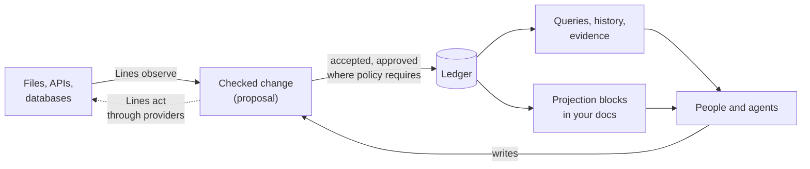
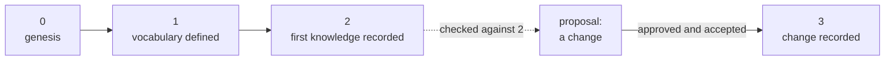
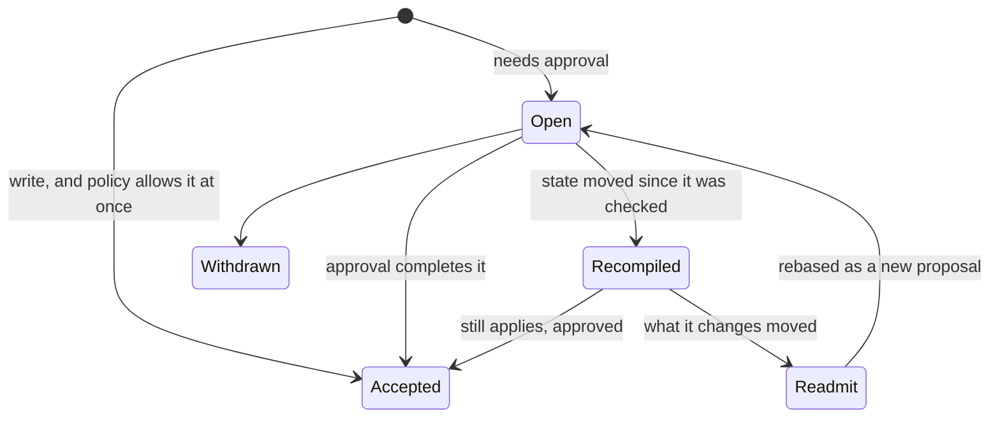
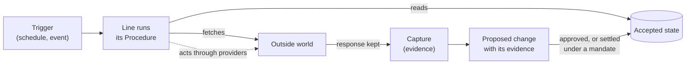

# Concepts

This page explains the ideas Cruxible is built on: what each one is, and what
it gives you. The [Quickstart](quickstart.md) shows them in use; the [CLI
reference](cli-reference.md) and [MCP tools](mcp-tools.md) list every
operation.

## What Cruxible is for

Teams of people and agents act on shared knowledge every day: which of your
systems a new vulnerability actually reaches, why a design decision was made
and whether it still holds, which leads an investigation has already ruled
out, what an agent has checked and what it only assumed. Most of that
knowledge lives in documents, tickets, chat threads and agents' context
windows, and it fails in familiar ways:

- it drifts out of date, and nobody notices;
- it piles up instead of settling: notes and Markdown files grow by
  appending, and what the team actually believes now is buried somewhere in
  them;
- it gets re-read and re-interpreted every time: each agent session starts by
  re-ingesting the same documents to work out what the team believes, paying
  for it in tokens and time, and two agents reading the same pages can come
  away believing different things;
- it gets overwritten, especially when several agents work at once, and the
  earlier version and the reason for the change are lost;
- two copies disagree, and nobody can say which one is right;
- an agent acts on it without being able to tell a checked fact from a guess.

Cruxible isn't a new source of truth: your databases, APIs, documents and
tickets stay that. Cruxible maintains what your team believes about the world,
drawn from those sources, as **hard state**: typed values, each stored with
the reason and the evidence behind it, changed only through checked and
approved changes, with a complete record of what was believed, when, and why.

Two costs shape how it works. Beliefs are acquired when a question needs
them, so knowledge costs what your questions cost, not what the world
contains: a model is never complete, and doesn't need to be. And beliefs are
kept consistent at the cost of what changed: when a source changes, only the
beliefs resting on it come back for review. Because a model is never complete,
an absence means "none" only inside a scope someone has read in full;
otherwise it means "unknown".

## The approach

- **A symbolic model of your world.** You declare the kinds of thing your team
  cares about, the fields each can have, and the relations between them.
  Cruxible holds the current state of that model, and checks every change
  against it.
- **Beliefs, with their reasons.** Every value is a Claim: something the team
  or an agent believes, stated with its rationale and the evidence it rests
  on, so any answer can be traced back to where it came from. Each Claim
  carries a verdict on how well its evidence holds up, so an agent reading the
  team's current beliefs can tell solid ones from weak ones without digging.
  Anyone can attest to a Claim, signing their support, contradiction or
  uncertainty, without changing it.
- **Knowledge that hardens.** Teams still think in prose. A write can add a
  section to a Markdown document and, in the same change, record the Claim
  that rests on it: the explanation stays readable in the repository, and the
  belief it supports becomes a typed, shareable value instead of one more
  paragraph. Once a belief is hardened into a Claim, agents read it directly,
  with its evidence attached, instead of re-reading and re-interpreting every
  document it came from, and every agent reads the same answer.
- **Many writers, nothing overwritten.** A write based on a value someone else
  has since changed is refused rather than silently winning. A disagreement
  can stand as a competing value that stays visible until it's resolved. And
  nothing is ever erased: every earlier value stays in the history.
- **Knowledge as code.** The vocabulary is declared and versioned. Changes are
  proposed, checked and reviewed before they land, like code, and can require
  someone else's signed approval. The record of it all is a Git repository.
  Vocabularies, queries and pipelines ship as kits that other teams install.
- **Connected to the world.** Cruxible points at your files, APIs and
  databases rather than copying them. A Claim cites the passage or the
  fetched response it rests on, and passages of your documents can be
  projections of the state, flagged when what they summarize changes. Lines
  are pipelines that observe the outside world and act on it through
  providers. What they find lands as proposed changes with their evidence
  attached, which are approved like any other change, or settled on their own
  only where a mandate allows it.
- **Questions over the whole graph.** Queries follow relations between things
  and answer the same way every time, at a named point in history.

Put together, knowledge flows in from people, agents and the outside world,
is checked and accepted into one ledger, and flows back out as answers and as
the documents people read:

No language model runs inside Cruxible: people and agents supply the
judgment, and Cruxible checks it, records it and serves it back,
deterministically. Cruxible never decides what a contradiction, a refusal or a
drifted source means; it shows it, and a person or an agent decides.
Consequences follow only from policy you author, such as a rule for what a
contradicting attestation does to a Claim, or a mandate that lets a Line
settle changes on its own.

The rest of this page builds the system up from its foundation: the ledger.

## The ledger

Everything in Cruxible rests on one record. Each body of knowledge, an
**instance**, is kept by a background server, the **daemon**, in a
**ledger**: a Git repository that only the daemon writes to. That gives the
team exactly one place where knowledge is accepted, and one way in. Every
accepted change becomes one commit in the ledger, called a **generation**,
numbered from 0, the instance's genesis. Everything else that shows knowledge,
such as the daemon's search indexes, the files in your workspace, or a table in
a document, is derived from the ledger: when they disagree, the ledger is
right, and anything derived can be rebuilt from it. Large bodies, like the
bytes of a web page fetched as evidence, sit beside the ledger in
content-addressed storage, named by their digest, and the ledger refers to
them.

A change adds a generation on top of the last and never rewrites an old one,
so nothing is ever lost: every earlier state stays readable, and every value's
history says who changed it, when, and the reason they gave. A proposed change
is evaluated against the generation it was made on, and only becomes the next
generation once it's accepted:

Every generation has a **coordinate** that names it exactly:

- the Git object ID of its commit, which pins the ledger's exact contents;
- the semantic root, a digest of what the knowledge means;
- the generation root, a digest of the generation itself;
- the compiler digest, which names the rules that interpreted it (see [The
  compiler](#the-compiler)).

Every read is answered at a coordinate: the current head, unless you ask for
an earlier one. Because the coordinate pins both the knowledge and the rules
that read it, the same question at the same coordinate always gets the same
answer, and every answer can name the exact state it came from. Here is a
coordinate, as `cruxible whoami --json` reports the current one:

~~~json
{
  "git_oid": "d4cdcae9625a1a3f016cf0a2ff58aea8b3eecb58",
  "semantic_root": "sha256:5b54f3105253749290c6a13beb3053fb2303880ac37fc14bdbefb30d45789f22",
  "generation_root": "sha256:a9f5262235896fb4d8dfdf0df27aebf4cb55d98fc1fcc5542b90eeb22d546270",
  "compiler_digest": "sha256:8b1fc4c429fbbdc9eee3915dc3c22af64fdbdba3465795ceb270b01371f899bd"
}
~~~

The ledger also makes every change verifiable. The daemon signs each
generation, and an approval is a signature made with the approver's own key
over the exact change, so you never have to trust a log line saying something
was approved: the signature is in the ledger. And because the ledger is Git,
it works with tools you already have. A proposed change is a branch you can
diff before it's accepted, and the ledger can be mirrored to a remote
(`cruxible ledger set-mirror`) for reviewers and auditors to fetch.

## Knowledge as Claims

Cruxible models your world as things, their fields, and the relations between
them. Declaring that model is what lets people and agents describe the same
world the same way, and lets Cruxible check every change against it.

To make these ideas concrete, the rest of this page uses a domain whose
relationships everyone already knows: car parts and the vehicles they fit. A
parts catalog is a solved problem in practice; it's here because nobody has to
learn it first. The same model applies to whatever your team actually works
on.

A **Subject** is a thing the instance knows about, named `kind/id`:
`catalog.part/bp-1142` is a set of brake pads, and
`catalog.vehicle/honda-civic-2019` is a car. Kinds are dotted names you
choose. A **SubjectKind** declares how a kind's Subjects are named: by the
values of one or more key fields (a key that names one Subject, `unique`, or
usually one, `hint`), or by a minted id. A new Subject is created by naming its
kind and key, so the same key always names the same Subject, however many
writers mention it.

A **ClaimType** defines one field of a kind. It names the predicate
(`catalog.part.category`, whose field name is `category`) and says:

- what the value is: a literal checked against a JSON schema, a reference to
  another Subject, or exact content;
- whether a Subject holds one value or many;
- which roles a Claim may take (`normative`, `observation`,
  `environment_binding`, `derivation`);
- which evidence it admits, and how competing values resolve.

Because every field is declared, a write that puts a value where it doesn't
belong, like a category that doesn't exist, is refused before it lands, with
the nearest valid choice. A ClaimType whose value is another Subject is a
typed relationship: `catalog.part.fits` points from a part to the vehicles it
fits, and refuses a part that "fits" another part. Relationships make the
model a graph, so "which parts fit this car?" and "what replaces this part?"
are questions with exact answers.

A **Claim** is one value of one field about one Subject: the statement, its
role, the evidence it cites, and the rationale its author gave. A value
without its reason is a rumor; a Claim says who believed it, why, and on what
evidence, so a reader can judge it, and a later reader can find out why it was
believed at the time. A Claim has an ID (`CLM-…`) and a history of revisions.
Resolution places it in its slot as accepted, conflicted, overturned or
refused, and retiring it ends it with a reason (`was-rescinded`, `was-wrong`
or `superseded`). For example, the Claim that brake pads `bp-2210` fit the
2019 Civic, and what it rests on, a line of the supplier's catalog:

~~~text
$ cruxible get CLM-abbe35eeffed479c1b18674c93880802
catalog.part/bp-2210  fits = catalog.vehicle/honda-civic-2019
CLM-abbe35eeffed479c1b18674c93880802  verdict=supported status=accepted revision=1

$ cruxible get CLM-abbe35eeffed479c1b18674c93880802 --detail evidence
value: catalog.vehicle/honda-civic-2019
capture CAP-a0a989ec8fe7  CaptureContract:cruxible.foreign-source.catalog v1  source=catalog  ...  evidence admitted
rationale: Acme's 2026 catalog lists bp-2210 for the 2019 Civic.
~~~

Every Claim also has a **verdict** that says how well its evidence holds up:
`supported`, `uncovered` (no admitted evidence), `stale`, `contradicted`, or
`unresolved`. Reads carry **flags** beside values (`stale`, `contested`,
`contradicted`, `uncovered`, `unsure_hold`), so weak knowledge looks weak: an
agent can tell a catalog-backed fitment from an unsupported guess without
opening either.

Anyone can **attest** to a Claim with a signature: `cruxible claim attest
CLAIM_ID` with `--support`, `--contradict` or `--unsure`. An attestation is
recorded beside the Claim and never changes it; `--unsure` holds the Claim's
contested `next` rows until what you examined changes. When you have evidence
against a Claim, attest to it or record what you observed instead, rather than
minting an adjacent inverse concept ("does not fit").

## Evidence

Every Claim rests on evidence, so any answer can be traced to the exact
passage, file or fetched response it came from, not a paraphrase. A Claim's
evidence is one or more of:

- **its author's own words**: the `--because` text every write carries;
- **a citation**: a passage quoted from a catalogued workspace file
  (`--evidence-file PATH#ANCHOR`, `cx.file(path).anchor(...)` in the SDK), like
  the line of the supplier's catalog above;
- **a Capture**: retained evidence recorded under a CaptureContract, for
  example a supplier API response that a Procedure fetched (`--capture CAP-…`,
  or `--evidence-contract` for the newest one about the Subject).

A ClaimType's evidence rules say which of these support a value of that field.
A Claim whose evidence the rules do not admit is still recorded, with the
verdict `uncovered`, and `next` asks someone to bind better evidence. If a
cited passage later changes, `next` reports the drift and asks someone to
re-check the Claim, so a Claim never silently outlives its evidence.

The commonest evidence is something someone wrote down. Rather than keeping
notes beside the knowledge, where they pile up, a single write can add the
prose to a Markdown file and record the Claims that rest on it:

~~~yaml
because: Acme catalog 2026, brakes page.
docs:
  - op: append
    id: bp1142
    file: docs/fitment.md
    under: [Fitment notes]
    text: |
      ## bp-1142 front brake pads

      Acme catalog 2026, page 12: fits the 2019 Honda Civic (front axle).
changes:
  - {op: add, subject: catalog.part/bp-1142, field: fits,
     value: catalog.vehicle/honda-civic-2019, evidence: {kind: section, ref: bp1142}}
~~~

The note lands in `docs/fitment.md`, where people keep reading it, and the
fitment lands in the ledger citing it: the explanation stays readable in the
repository, and the belief it supports becomes a typed value that queries,
agents and other teams can use.

### Files, citations and Documents

The file catalog, `.cruxible/files.yaml`, gives each workspace file a stable
name. An entry needs only a `name` and a `locator` (its path) to be cited;
`cruxible files add NAME PATH` writes one. Two different things can rest on a
catalogued file:

| | Citation | Document |
|---|---|---|
| What it is | A Claim quoting a passage of the file as evidence | A governed copy of the whole file: its exact bytes as a versioned artifact with review history |
| When to use it | A Claim relies on what the file says | The file's wording is itself the governed thing: a policy, a spec |
| When the file changes | `next` reports `citation_drifted`; re-bind the Claim to the new text or retire it | `next` reports `document_modified`; `files check` shows the detail |
| How | `set --evidence-file`, `cx.file(...)` | Add `document_id`, `document_kind`, `title`, `media_type` and `governance_scope` to the entry, then `files compile` and `files propose` |

Most usage is citations. A Document whose bytes are not a workspace file (for
example bytes a remote agent supplies) goes through `body store` and
`document propose` instead. `coverage resolve` answers which Claim citations
occur in given file bytes: a whole file, a line range, or `grep -n` output on
standard input.

### Writing sections

A `write` takes `docs` append and replace operations on heading paths the
author chooses, and a change cites the section with `{kind: section, ref:
ID}`, or an existing section with
`{"kind":"section","file":"docs/fitment.md","section":["Fitment notes","bp-1142 front brake pads"]}`.
The selected bytes include the heading and its own body, ending before the
first child. Prose authored by that write counts as the author's own words: a
retained self-source Capture keeps the basis, and an ordinary file-copy
citation records its location for drift. Existing sections are file evidence.
ClaimType rules still admit their named contracts; captured-only requirements
reject own words. In the SDK, `evidence=cx.section(file, heading_path,
text=...)` authors the section and cites it in the same write.

The client applies only agent-authored text after admission, including when
approval remains pending. The daemon receives bytes and logical source IDs,
never opens workspace paths, and never writes prose. Dry runs write nothing.
Section digests provide compare-and-set: concurrent changes to other sections
can rebase, while a changed target yields a repair. Check each document
outcome's `written` flag. Editing a Document also names the `files propose`
follow-up.

### Captures a run must have produced

A Capture under a contract the daemon fetches for (not one recording an
author's own words or a quoted file) is evidence only when the journal records
a run producing it: a Source read the run selected, or an `emit_capture`
terminal. That is what makes fetched evidence trustworthy: bytes can't be
passed off as something a run observed. Anything else holding Capture bytes,
such as bytes put with `body store` or a Source read its acquisition rule did
not select, is refused when first cited (`capture_production_unproven`). A
version-1 Capture under such a contract carries no producer receipt and is
refused when first cited (`capture_v1_citation_refused`); a Claim already
citing one keeps it. A proposal is held to this again when it is activated, so
one admitted before the rule existed that cites such a Capture is refused
(`cruxible.proposal.capture_production_unproven`): readmit it to see which
citation fails, then resubmit it citing a Capture a run produced.

### Observations over time

Repeated observation never overwrites evidence. Each fetch or read a run makes
is its own Capture with its own time and provenance; Captures of identical
bytes share storage and match each other without collapsing into one
observation. What a new observation does to accepted state depends on what it
shows:

- **The same value again** changes no Claim. Re-checking the supplier's
  catalog and finding the same fitment is recorded beside the Claim, and keeps
  it fresh: a ClaimType's evidence age counts from the latest re-observation,
  not the first Capture.
- **A different value** is a new statement, proposed as a revision like any
  other change. Claims that depend on the old value are not revised for you:
  `next` resurfaces them, and an agent decides what the change means for each.
- **A failed observation** is a failure to observe, recorded in the run's
  journal. It is not evidence that the value changed, vanished or stayed the
  same.

Keep the boundary by what information supports, not by how often it changes.
Run bookkeeping (started, timed out, retried) stays in the journal.
Observations that conclusions rest on are retained as Captures, including
negative results when a conclusion relies on absence. Accepted Claims hold the
assertions and interpretations you govern. A rapidly changing measurement,
like a supplier's stock level, can be captured on every poll without a Claim
for every fluctuation; propose a Claim when a value crosses something that
matters.

What counts as a meaningful change is the consumer's rule, not core's: a
Procedure compares what it observed with accepted state (its state tap) and
proposes only the differences it is written to care about. When a Line notices
something worth attention but not a proposal, it posts to its inbox.

## Changing knowledge

Nothing changes the ledger except an accepted change, and every change, from a
person, an agent or a Line, is checked against the vocabulary and the current
state before it can be accepted. A bad change is refused with a reason and a
repair, and leaves nothing half done. Every change is a **change set**: one or
more changes, proposed against the generation they were made on, and accepted
or refused as a whole. Two lanes lead to a change set, over the same engine.

**Values** change with `set` (replace one field's value), `add` (one more
value in a many-valued field), `retire` (end one Claim, by its ID or by
naming its value) and `write` (several of these, plus any document sections,
as one atomic change with one reason). In the SDK, `cx.set(...)`,
`cx.retire(...)` and `cx.changes(because=...)` with `.set`, `.add`, `.retire`
and `.write()`. A value change is accepted in the same call when the approval
policy and the caller's tier allow it, and otherwise stops at a proposal that
names who may approve it. `--no-accept` stops it at a proposal anyway;
`--dry-run` runs every check and writes nothing; `--expect` and
`--expect-absent` make it compare-and-set on the current value.

**Definitions** go through `authoring`: Subjects, named queries, Procedures,
Blueprints, Lines, Triggers, mandates, acquisition policies and the approval
policy, alone or as members of one change set. `cruxible authoring submit
PAYLOAD` checks and lands a payload in one call when no approval is required
and the caller may activate; otherwise the typed outcome names the proposal,
the reason it stopped and the next step. `--no-accept` keeps the proposal;
`--dry-run` returns every refusal without saving anything. For staged work on
a large definition, `authoring compile` keeps a durable intent that `compile
--intent-id`, `preflight` and `submit --intent-id` revise and advance. In the
SDK, `cx.changes(rationale=...)` collects definitions and Claims into one
change set that `.submit()` sends. `cruxible authoring example NAME` prints a
template for each input.

**Vocabulary** keeps its own group, `cruxible claim-type`: `propose` defines
or revises a ClaimType, `migrate` succeeds one and decides, in the same change
set, what happens to every Claim that depends on it (carry it to the new
version, retire it, or say it again under the new vocabulary), and `upgrade`
moves older ClaimTypes to the current format. Changing vocabulary disposes
dependent Claims, so it is never a side effect of another write. With floor
delivery on, the daemon rewrites the workspace's typed stub
(`.cruxible/world.pyi`) when an activation changes vocabulary; with it off,
rerun `cruxible stub`.

Every payload argument accepts `-` for standard input, so a heredoc or a pipe
works and no throwaway file lands on disk. Real artifacts stay files:
Procedure source, signed source bundles, kit directories, key directories,
cited workspace files and pages.

### Proposals, approval and activation

A **proposal** is a frozen candidate: the exact change, evaluated against the
accepted base it names. It is not accepted state. A refused proposal is kept
with its diagnostics, and `get PROPOSAL_ID` reads any proposal, its status, and
for a refusal the code, message and repair. `proposal review` shows the
candidate and how to diff it with plain Git.

The instance's **approval policy** (`ApprovalPolicy:instance`) decides how much
review a change needs. It is either `self_approval_allowed`, where an author
may approve and activate their own changes, or
`independent_approval_required`, where a governed change needs an approval
from someone other than its author, so whatever an agent proposes waits for a
person. Writes, provider installs, and kit adds and removes all land at once
when the policy requires no approval and the caller's tier may activate, and
otherwise stop at a proposal.

An **approval** is a signature over the exact candidate, made with the
approver's private key on the client; only the signature reaches the daemon.
**Activation** checks the approvals and the policy and advances accepted state
by compare-and-set. When an approval completes what the candidate needs and the
approver may activate, the same `proposal approve` activates it (`--hold` signs
only, and someone runs `proposal activate` later).

Because every change records the generation it was made on, many writers can
work at once without silently overwriting each other. A proposal becomes
stale when another generation is accepted after it was evaluated. Approving,
activating or readmitting it recompiles it at the current head, as a fresh
proposal that supersedes the old one, from the authoring, write or Procedure
inputs it retained; normal approval policy applies, approvals of the old
candidate don't carry over, and providers and state-tap reads are not
repeated. If what it changes has itself moved in the meantime, the recompile
is refused and `next` lists the proposal for `proposal readmit`, which rebases
it as a new proposal to review. Proposals of other origins keep byte
readmission, and this work happens only on those explicit operations.
`proposal withdraw` retires a proposal that will never activate.

## Who acts

Every governed act in Cruxible is attributed, so history can say who, not
only what, and every caller's power is bounded. Two different things answer
"who is this", and they are easy to confuse:

- A **principal** is a governed identity in the instance's ledger: a public
  key with a kind (owner, ordinary, or recovery). Principals attribute every
  governed act; approvals and attestations are signatures made with the
  principal's private key, which stays in a key directory on the client
  (`~/.config/cruxible/keys/` by default). Principals are added, rotated,
  recovered and revoked with `cruxible principal`, each a governed change.
- A **credential** is a daemon bearer token. It decides whether a caller may
  reach the daemon's endpoints and caps what it may do with a tier:
  `read_only`, `governed_write` (propose and author), `graph_write` (also
  approve and activate) or `admin` (also operator acts such as credentials,
  hosts, principal changes, compiler upgrades and provider installs). An agent
  with `governed_write` can propose and author but never approve or accept, so
  its work always waits for a person. Credentials are minted, rotated and
  revoked with `cruxible credential`.

A Unix-socket daemon runs with auth off by default: every process of your OS
user is equally trusted, there are no bearer tokens, and the principal ID a
process sends is a claim of identity, not authentication. A TCP daemon must run
with `--auth`, and then each credential is bound to one principal. Either way,
an approval still needs the principal's private key. Local key directories give
attribution and hygiene, not a security boundary between processes of one OS
user.

`cruxible init` makes you the owner and remembers your settings; `cruxible
principal add` registers another principal and writes its settings to its key
directory; `cruxible context use --principal ID` switches which principal the
CLI acts as; `cruxible whoami` reports who you are and whether you can author.

## Reading

Reads answer from accepted state, the same way every time: there is no
ranking or sampling between the question and the answer. Three verbs read on
every surface (CLI, MCP and SDK):

- **orient** maps the instance: each Subject kind with its fields and counts,
  artifact counts, who you are, what needs attention, and the next commands.
  `--kind K` reads one kind in full; `--section S` pages one family
  (documents, procedures, claim types, queries, interfaces, runs, lines,
  captures, predictions, mandates, principals, policies, ...).
- **query** answers a question as rows of values with flags: a kind with
  `--where`, `--select`, `--follow` and `--order-by`, `--contains` for text in
  any value, a named query with `--name`, or a full query spec with `--spec`.
  `--follow` walks a relation: `cruxible query catalog.part --follow
  fits:vehicle --select title,vehicle.model` lists each part with the models
  it fits. Kinds `ClaimType`, `Procedure`, `Trigger` and `Line` list
  definitions.
- **get** reads one thing by any reference: `kind/id`, a Claim ID, a proposal
  ID, `ClaimType:`, `Document:`, `Procedure:`, `Blueprint:`, `Line:`,
  `Trigger:`, `Principal:`, `ProviderInterface:`, `query:` and others. Values
  come first; `--detail` goes to `evidence`, `why`, `history`, `proof`, or a
  Document `body`.

The past is a read away, too. `orient`, `query` and `get` accept `--at` to
answer as of an earlier generation, and `get --detail history` lists each value
a Subject's fields have held, with who changed it, when and why, so "what did
we believe about this part last month, and why did it change?" has a direct
answer. `since GENERATION` lists exactly what changed after a generation.

In a summary read, a text value over 500 characters is shown as a truncated
preview that says how long the value is and names the exact read of the whole
value (`get REF --detail evidence` at the generation it came from), so a long
value never passes for a short one. `cx.read_whole(preview)` makes that read in
the SDK; `cx.read_whole_many(previews)` reads many of them in a few batched
reads, each pinned where its preview was read.

### The floor

The floor puts the current state where agents already look: a directory of
plain files, `.cruxible/floor/`, with one file per Subject
(`current/<kind>/<id>.yaml`, each line a value and its Claim ID) and the
accepted definitions under `ontology/` (a card per kind with each field's type,
cardinality, evidence, owner and who settles it; INDEX files of the
ClaimTypes, CaptureContracts, queries, Lines and installed kits), for
orientation and grep. It is eventually current: it follows accepted state
shortly after each change, so read exact values after a write with `get` or
`query`, not the floor.

A local daemon delivers the floor itself to a registered workspace, after each
accepted generation, while delivery is on (`cruxible floor delivery on|off`;
`init` and `workspace attach` turn it on, and `workspace attach
--no-floor-delivery` leaves it off). Anywhere else, such as a remote daemon or
with delivery off, pull it with `cruxible floor export` or
`cx.refresh_workspace()`.

`.cruxible/world.pyi` does the same for the vocabulary, as Python types an
editor or a model can complete. It depends on the vocabulary alone (Subjects
are typed by kind), so floor delivery keeps it current by rewriting it only
when the vocabulary changes; `cruxible stub --out PATH` writes one explicitly.

## Staying in step

Knowledge goes stale in two directions: the world moves on from what the
ledger says, and the documents people read move on from the ledger. Cruxible
watches both and tells you, so nothing depends on someone remembering to
check.

### Work queues

Three queues tell you what to do, each a read:

- **next** is what is wrong or waiting on you, each row with the exact
  operation that repairs it: stale or drifted evidence, stale proposals, stale
  blocks, Lines with gaps, available compiler upgrades, and more. It is one
  to-do list for people and agents alike.
- **audit** ranks Claims worth verifying, by stake, weakness and recency.
- **curation** (beta) lists ontology-maintenance patterns that detection found.
  Detection runs only when a `curation-detect` Trigger aimed at the
  `curation.detect` action is authored (none is seeded), never on `next`'s
  path; `curation list` only reads. Each item takes one ruling: `overrule`
  closes it as not applying, permanently; `suppress` hides the item, or with
  `--scope lineage` also every successor its pattern opens; `unsuppress` lifts
  a suppression; and `accept-fixed` links it to the accepted proposal or
  generation that fixed it.

### Projection blocks

A summary that no longer matches what the team knows is worse than none.
A **projection block** is a delimited passage of a workspace page that
reflects accepted state, with a stamp recording exactly what it reflects, so
Cruxible can tell the moment it no longer does. Blocks are either:

- **rendered**: the output of a named query, written by `block repin
  --render` (a table or a list); or
- **authored**: prose you or an agent wrote, stamped against the Claims or
  queries it summarizes.

Both are governed the same way. When the state behind a block moves, `next`
reports it (`projection_backing_stale`, or `projection_dirty` when someone
edited the block's text) and `block sync` shows it. A stale rendered block
regenerates itself: `block sync` re-renders it from its query and repins it.
An authored one needs only the staleness signal: you re-check it, and rewrite
or repin it. See [Projection blocks](declared-blocks.md).

For example, the parts table on a page about the 2019 Civic, rendered from the
named query `catalog.parts_for_vehicle`, and the same table after `block sync`
once a replacement brake pad was recorded:

~~~markdown
<!-- cruxible:block:parts:ref:444ca169ec81 -->
| subject | category | title |
|---|---|---|
| catalog.part/bp-1142 | brakes | Front brake pads |
| catalog.part/wb-330 | wipers | Wiper blade, 22 inch |
<!-- /cruxible:block:parts -->
~~~

~~~markdown
<!-- cruxible:block:parts:ref:abfeac833d6e -->
| subject | category | title |
|---|---|---|
| catalog.part/bp-1142 | brakes | Front brake pads |
| catalog.part/bp-2210 | brakes | Ceramic front brake pads |
| catalog.part/wb-330 | wipers | Wiper blade, 22 inch |
<!-- /cruxible:block:parts -->
~~~

The stamp in the opening marker (`ref:…`) is how Cruxible knows which state the
passage reflects. A page can hold both projection blocks and passages that
Claims cite, but never in the same place: a Claim can't cite a block, so a page
never vouches for itself.

## Predictions

A belief is only as good as its track record. A **prediction** turns "we
expect this" into a governed test of an accepted Claim: which later
observation settles it, by what mechanical rule, within which window. For
example, that a supplier's stated delivery date for a part holds, checked
against when the part is recorded as received. Settled predictions show the
team which sources and which agents to trust. `prediction propose` proposes
one; `prediction settle` settles it from the accepted observation Claim;
`prediction list CLAIM` lists the accepted predictions that test that exact
Claim. A prediction is stored as a resolution contract, so `get
ResolutionContract:NAME` reads one.

Settling is an explicit act; nothing settles a prediction on its own. Any
accepted observation inside the window can settle it, and once the window has
closed `next` lists the prediction as `prediction_settleable` with the settle
command. A window that closes with no accepted observation inside it cannot
settle (`prediction_deadline_passed`); Cruxible gives an unobserved window no
meaning of its own, so retire the contract, or record the observation you did
make as a revised Claim and predict again.

## Procedures and Lines

Procedures and Lines are how Cruxible keeps knowledge in step with the world
without someone doing it by hand: pipelines that observe, and act, under
rules you declare.

### Procedures, Blueprints and providers

A **Procedure** is a governed, deterministic graph: it reads accepted state
(named queries and Claims), acquires observations through Sources, calls
providers, transforms and routes values, and ends in a result or a terminal
that retains a Capture, proposes a change set, or settles one. A Procedure
might fetch a supplier's fitment API for every part, compare what it finds
with the recorded fitments, and propose the differences, each with the
response it fetched as evidence. Every provider it calls is pinned to one
exact implementation, so a run is reproducible from its record, and you can
always answer what a pipeline did and why it proposed what it did. `cruxible
procedure run NAME INPUT` runs one directly; `get Procedure:NAME` says whether
it runs directly, only as a Line (its terminals act only there), or not at
all. A Procedure may declare measurements, which `procedure measure` evaluates
once due and `procedure readings` reads.

A **Blueprint** is the same definition with one or more provider slots left
open, each naming the ProviderInterface it needs. It never runs.
Instantiating it (a `blueprint_instance` authoring input) binds one installed
provider per slot and produces an ordinary Procedure that records its
Blueprint and bindings. `get Blueprint:NAME` lists each slot and the installed
providers that fit it.

A **ProviderInterface** is a typed contract (input, output, effect); a
**Provider** is an installed package that implements interfaces. Interfaces
are what make a Procedure's action space explicit: what it may do to the
outside world is whatever effects its pinned providers' interfaces declare. An
interface is registered once per instance by its definition, so every package
implementing the same definition binds the same registration, and a slot typed
by it takes any of them; a provider runs only the kinds of input it claims.
Every instance starts with the built-in `workspace.file` provider. Others
install with `cruxible provider install`, or arrive with a kit (bundled, or a
default installed by name); installing grants no permission to run anything.

In Python, `@procedure` from `cruxible_client.authoring.source` turns a
decorated function into a `ProcedureSource`, compiled into the same governed
graph; its `slots=` declare open slots by interface, and a source with
unbound slots builds a Blueprint. See the [Procedure source
reference](procedure-source.md).

### Lines, Triggers and mandates

A **Line** runs a Procedure under its own inputs, budgets, authority ceiling
and acquisition policy, and records each run on the Line's history. A
**Trigger** says when: on a cadence, a cron schedule (UTC), when a Capture
lands under a CaptureContract, when a window closes, or when a generation is
accepted.

Autonomy is granted explicitly, and can be taken back. Lines are enabled, not
armed:

- A Trigger aimed at a Line does nothing until a principal enables the Line
  (`line enable`). Enabling needs governed write, even for a Line that only
  observes.
- Enabling pins the Line version and the exact Trigger versions aimed at it.
  Changing the Line or any of its Triggers stops the enablement until someone
  enables it again, which is consent to the new schedule.
- A Line that proposes or settles changes needs a current **mandate**
  covering its Procedure, and refuses to enable without one. A settle mandate
  names what the Line may settle on its own and what happens otherwise. A
  Procedure that settles still only proposes when its Line is capped at
  `propose` (`max_authority`) or its only mandate grants propose, so one
  Procedure serves a Line before and after it graduates to settling.
- `line run` always runs one manual occurrence now, under the Line's own
  settings; it never consumes or waits on a Trigger.
- Timed Triggers tick on their schedule's own grid. Enabling or resuming a
  Line never runs a missed tick; `line evaluate` over the missed range records
  every tick it skipped, and `line dispatch` runs them (`line evaluate
  --dispatch` does both). `next` names the exact command for each gap, for
  example after the daemon was down.

Internal actions (floor refresh, evidence sweeps, prediction retries, and
curation detection once its Trigger is authored) also run on Triggers, and
need no enablement.

"Arm" has one meaning: a labeled branch of a Procedure graph, such as a
guard's true or false edge, which measurements can read at `arm` grain to
compare experiment arms.

## Kits

A **kit** is a release of definitions (ClaimTypes, CaptureContracts, named
queries, Procedures, Blueprints, ProviderInterfaces and acquisition policies)
that another instance installs and upgrades as one reviewed change set. A
parts supplier could publish a kit with the vocabulary for parts and vehicles,
the `parts_for_vehicle` query and a Line that checks its fitment API, and
every garage that installs it describes parts the same way. See
[Kits](kits.md).

## The compiler

The **compiler** is the deterministic interpretation of the ledger, named by
its digest in every coordinate. Installing a new Cruxible release never
changes accepted state; adopting a new compiler revision is a governed change.
That's what lets an old coordinate keep giving the same answer: the rules that
read it are pinned along with the knowledge. See [Upgrading](upgrading.md).

## Hot and cold paths

High-rate activity (runs, attempts, logs, intermediate results) is retained
as operational exhaust, not as accepted state. Procedures and Lines select
from it and propose what should be governed. The exhaust records what
happened; the ledger records what has been accepted.

This keeps the ledger small and meaningful. A supplier's stock level polled
every minute stays in the exhaust; the Claim that a part is discontinued,
backed by the poll that showed it, goes to the ledger.
