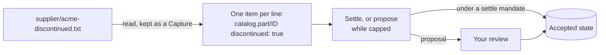

# Lines and automation

Some upkeep is the same every time: re-reading a supplier's list of
discontinued parts, re-fetching a price that expires, checking a feed for
new notices. Nobody should have to remember to do it, and nobody should have
to trust a script that writes straight into what the team knows. In
Cruxible, a **Line** does that work. It runs a fixed, checked **Procedure**
on a schedule or when something lands. What it finds arrives the way anyone's
change does: as a proposal citing the evidence it read, reviewed under your
approval policy. It keeps doing that until it has earned the right to land
changes itself.

This guide covers the pieces of automation, one worked example from writing
the Line to letting it settle on its own, the inbox for findings a Line
can't decide, and recovering work the daemon missed. It uses the car parts
example from [Concepts](concepts.md#knowledge-as-claims).

## The pieces

| Piece | What it is |
|---|---|
| **Procedure** | A fixed graph of steps: read accepted state, read a source (keeping what it read as a Capture), transform, and end by posting to the inbox, proposing a change or settling one. Every provider it calls is pinned, so a run can be replayed and explained. |
| **Line** | A Procedure with its inputs, its budgets and an authority ceiling (`max_authority`): `observe`, `propose` or `settle`. |
| **Trigger** | When a Line runs: a cron schedule, a cadence, a Capture landing, a window closing, or a generation being accepted. |
| **Mandate** | The grant that lets a Procedure propose, or settle within a scope. |
| **Enablement** | Your consent for a Line to run on its Triggers. |

A Procedure never reads the clock. Time enters only through Triggers, so
"every morning" is a cron Trigger, and the same run on the same inputs gives
the same result. Procedures are written once, in Python with the SDK (see the
[Procedure source reference](procedure-source.md)), or come ready-made in a
kit.

## A worked example: discontinued parts

Acme publishes the part numbers it has discontinued, and the team keeps a copy
in the repository at `supplier/acme-discontinued.txt`, one part number per
line. The Procedure `catalog.acme-discontinued` reads that file and records
`discontinued: true` for each part it lists, citing the file as it read it:

Its last step settles. While its Line is capped at `propose`, that same step
proposes instead, so one Procedure serves the Line before and after it
graduates.

### Write the Line, its Trigger and its mandate

A Line, its Triggers and its mandate are definitions like any other, so they
go in through authoring as one change set:

~~~json
{"kind": "change_set", "rationale": "Check Acme's discontinued-parts list every morning; propose what it lists for review.", "members": [
 {"kind": "line", "name": "catalog.acme-discontinued", "procedure_name": "catalog.acme-discontinued",
  "acquisition_policy_name": "catalog.acquisition", "max_authority": "propose",
  "parameters": {"path": "supplier/acme-discontinued.txt"}},
 {"kind": "trigger", "name": "catalog.acme-discontinued-daily", "line_name": "catalog.acme-discontinued",
  "schedule": {"kind": "cron", "expression": "0 6 * * *"}},
 {"kind": "procedure_mandate", "name": "catalog.acme-discontinued-propose", "procedure_name": "catalog.acme-discontinued",
  "grants": "propose", "namespace": ["claims"], "valid_from": "2026-10-21T00:00:00Z", "expires_at": "2027-01-19T00:00:00Z",
  "resource_ceiling": {"max_wall_clock": {"microseconds": 120000000}, "max_provider_calls": 1,
    "max_capture_bytes": 1000000, "max_items": 1000, "max_repeat_attempts": 1}}
]}
~~~

~~~text
$ cruxible authoring submit automation.json --brief
outcome: accepted
...
~~~

The `parameters` are the Procedure's input, and `acquisition_policy_name`
names the rules for its sources (how old a reading may be, and what to do when
one is missing). Cron schedules are always UTC: 06:00 UTC, here. `cruxible
authoring example line`, `trigger` and `procedure-mandate` print templates.

### Run it once

`line run` runs the Line now, whether or not it's enabled:

~~~text
$ cruxible line run catalog.acme-discontinued
RUN-f4b3d8bd…: succeeded
Result: {"listed": 2}
Read list: supplier/acme-discontinued.txt (14 bytes, sha256:ef7766d0…)
Capture list: sha256:75f0fda7…
Proposal settle: sha256:84437408… candidate sha256:14fb95b1… (settle fell back: cruxible.settle.authority_capped_by_line_max_authority)
~~~

Its Line is capped at `propose`, so the settle step proposed. The proposal
reads like anyone's, with the run that made it and each item's reason:

~~~text
$ cruxible proposal review sha256:84437408…
...
Why:
  Proposed by Procedure catalog.acme-discontinued run RUN-f4b3d8bd… terminal settle
Changes (2):
  set catalog.part/af-208 discontinued: true  [CLM-79c37658…]
  set catalog.part/wb-330 discontinued: true  [CLM-1858ef00…]

Item reasons (2 of 2):
  ...
    Listed in Acme's discontinued-parts file.
~~~

Once approved, each Claim cites what the run read, not the file as it is
now:

~~~text
$ cruxible get CLM-79c37658… --detail evidence
value: true
capture CAP-a175ef6cc924  CaptureContract:catalog.supplier-file-v1 v1  source=acme.discontinued  observed=2026-10-21T19:41:54.870243+00:00  evidence: admitted
rationale: Listed in Acme's discontinued-parts file.
~~~

A later run that finds nothing new proposes nothing, and a Line keeps at most
one open proposal: a run whose change differs replaces it.

## Running on a schedule

A Trigger does nothing until the Line is enabled:

~~~text
$ cruxible line enable catalog.acme-discontinued
Line:catalog.acme-discontinued: enabled
Enabled by: YOUR_ID at 2026-10-21T19:46:01.895912+00:00
Matched through: 2026-10-21T19:46:01.895912+00:00
Pending: 0 automatic, 0 awaiting explicit dispatch
~~~

Enabling is consent to run on the Line's current definition and Triggers.
Changing either stops the enablement until someone enables it again, and
`next` says so:

~~~text
$ cruxible next
Status: line enablements stalled=0 stopped=1  next=cruxible orient --section lines
repair  consumer_stalled  Line:catalog.acme-discontinued  next=cruxible.line.enable
  repair: cruxible line enable catalog.acme-discontinued
~~~

Triggers fire only forward: a new Trigger never runs for times before it was
accepted, and enabling a Line never runs ticks it missed. `line disable`
stops it; a run already going finishes. `cruxible get Line:NAME` shows its
Triggers, enablements and recent runs, and `get ProcedureRun:RUN-…` reads one
run step by step.

| Trigger | Fires | Schedule |
|---|---|---|
| Cron | At each instant of a five-field expression, in UTC | `{"kind": "cron", "expression": "0 6 * * *"}` |
| Cadence | Every interval | `{"kind": "cadence", "interval_seconds": 3600}` |
| Capture landing | When a Capture lands under a contract, such as one a fetching Line just retained | `{"kind": "capture_landing", "capture_contract": "NAME"}` |
| Window close | When a window after such a landing closes | `{"kind": "window_close", "window": {"kind": "capture_event", "capture_contract": "NAME", "duration_seconds": 86400}}` |
| Generation accepted | When accepted state changes | `{"kind": "generation_accepted"}` |

A Capture-landing Trigger is how a fetching Line hands off to a parsing Line:
one reads the source on a schedule, and the other runs on what it read. The
daemon's own housekeeping (floor refresh, evidence sweeps) also runs on
Triggers; see [Internal triggers](cli-reference.md#internal-triggers).

## What a Line may do

A Line's `max_authority` caps it, and anything past observing also needs a
mandate for its Procedure:

- **observe**: read and retain what it read, and post to the inbox. No mandate.
- **propose**: propose changes, which wait for review like anyone's. Needs a
  propose mandate.
- **settle**: land changes without approval. Needs a settle mandate, which
  names the fields and kinds of change it covers and a condition each target
  must meet ([Review and governance](review-and-governance.md#delegating-to-automation)
  has the rules).

A Line without the mandate it needs refuses to enable. Mandates expire, so
renew them before they do.

## Earning settle

Settling is earned, not assumed. A Procedure can declare **measurements**,
checks that come due after it's accepted, so its record builds up as it runs.
`catalog.acme-discontinued` declares one: a week after acceptance, the saved
query of discontinued parts that someone has contradicted must be empty.

~~~text
$ cruxible procedure measure catalog.acme-discontinued --run-id RUN-f4b3d8bd…
nothing-contradicted: resolved (satisfied, RSR-2c4907ed…) reading=recorded PRD-4e96a550…

$ cruxible procedure readings catalog.acme-discontinued
nothing-contradicted: resolved readings=1 (satisfied, RSR-2c4907ed…)
PRD-4e96a550… nothing-contradicted procedure_unit satisfied run=RUN-f4b3d8bd…
~~~

When the readings justify it, **graduate** the Line: grant a settle mandate
and raise the Line to `settle`, in one change set reviewed like any other.
The mandate here covers only `discontinued`, and its condition, the saved
query `catalog.part_categorized`, holds only for parts the team has given a
category:

~~~json
{"kind": "change_set", "rationale": "Graduate the Acme discontinued check to settle: a week of runs, nothing contradicted.", "members": [
 {"kind": "procedure_mandate", "name": "catalog.acme-discontinued-settle", "procedure_name": "catalog.acme-discontinued",
  "grants": "settle", "namespace": ["claims"], "valid_from": "2026-10-21T00:00:00Z", "expires_at": "2027-01-19T00:00:00Z",
  "scope": [{"claim_type": "catalog.part.discontinued", "change_kinds": ["create", "revise"]}],
  "condition": {"query_name": "catalog.part_categorized", "binding_parameter": "part_id",
                "required_fields": ["category"], "fallback": "propose"},
  "resource_ceiling": {"max_wall_clock": {"microseconds": 120000000}, "max_provider_calls": 1,
    "max_capture_bytes": 1000000, "max_items": 1000, "max_repeat_attempts": 1}},
 {"kind": "line", "name": "catalog.acme-discontinued", "procedure_name": "catalog.acme-discontinued",
  "acquisition_policy_name": "catalog.acquisition", "max_authority": "settle",
  "parameters": {"path": "supplier/acme-discontinued.txt"}}
]}
~~~

The new Line version stops the old enablement, so enable it again. The
Procedure doesn't change, so its record carries over. Now a run lands its
change itself, and history still says where each value came from:

~~~text
$ cruxible line run catalog.acme-discontinued
...
Settled settle: accepted d0f3a27bdecf… (proposal sha256:dcc462a0…)

$ cruxible get catalog.part/bp-2210 --detail history --field discontinued
...
discontinued
  seq 30  d0f3a27bdecf  2026-10-21T19:47:04.647060Z  by YOUR_ID  stated  true  [CLM-75027a8f…]
      reason: Listed in Acme's discontinued-parts file.  (Procedure Procedure:catalog.acme-discontinued, run RUN-2fdbb704…)
~~~

When the list names a part the condition doesn't hold for (here `sp-77`, which
has no category yet), the run follows the mandate's fallback, and the whole
change goes to review:

~~~text
Proposal settle: sha256:9f0ade2a… (settle fell back: cruxible.settle.condition_incomplete)
~~~

Delegate facts copied verbatim from a source, like this list. Keep judgments
for review: whether a part still fits a car stays with a person.

## The inbox: findings a Line can't decide

A rule of thumb: propose when the automation can state the belief, post when
it can't. Acme also sends notices, such as recalls and price changes, and
deciding what a notice means for the catalog is a judgment. An observe-only
Line, `catalog.acme-notices`, posts each notice to the **inbox** instead:

~~~text
$ cruxible next
repair  line_inbox_unread  Line:catalog.acme-notices  next=cruxible.inbox.list
  repair: cruxible inbox list --line catalog.acme-notices --status unread

$ cruxible inbox list --line catalog.acme-notices --status unread
STATUS  ITEM  LINE  SEEN  LAST_POSTED
unread  INB-b73819240332  Line:catalog.acme-notices  -  2026-10-21T19:46:06.044545+00:00
  {"notice": "2026-10-20 Recall: bp-2210 ceramic pads, batch 4471, may delaminate under heavy braking."}
unread  INB-0152266fe7d8  Line:catalog.acme-notices  -  2026-10-21T19:46:06.044545+00:00
  {"notice": "2026-10-21 Price change: all wiper blades up 5% from 2026-11-01."}
~~~

`inbox get ITEM` shows the whole item and the run and Capture behind it. The
inbox is never accepted state. Judge each item and record what you decided:
write what you concluded and `link` the item to it, `dismiss` it with a reason,
or `ack` it as seen:

~~~text
$ cruxible write recall.yaml
accepted (generation 26, 67213e49bbae)
  set catalog.note/acme-recall-bp-2210-4471 title: Acme recall: bp-2210 batch 4471 may delaminate  [CLM-35798a58…; verdict supported]
  add catalog.note/acme-recall-bp-2210-4471 about: catalog.part/bp-2210  [CLM-c7e17e1b…; verdict supported]

$ cruxible inbox link INB-b73819240332 --subject catalog.note/acme-recall-bp-2210-4471
linked  INB-b73819240332  Line:catalog.acme-notices  -  2026-10-21T19:46:06.044545+00:00

$ cruxible inbox dismiss INB-0152266fe7d8 --reason "Prices are re-quoted from the November price list."
dismissed  INB-0152266fe7d8  Line:catalog.acme-notices  -  2026-10-21T19:46:06.044545+00:00
~~~

When a Line posts the same item again, it is counted as seen again and comes
back unread, with your last decision shown:

~~~text
unread (was linked)  INB-b73819240332  Line:catalog.acme-notices  x2  2026-10-21T19:48:39.945154+00:00
~~~

So a Line that re-reads a whole file on every run asks you to judge the same
items again. Post from a source that lists what's new, or expect to re-judge.

## Recovering missed work

A daemon that was down didn't run what was due meanwhile, and it never runs
missed work on its own. After a restart, `next` lists each gap with the exact
command that covers it:

~~~text
$ cruxible next
repair  line_coverage_gap  Line:catalog.acme-notices  next=cruxible.line.evaluate
  repair: cruxible line evaluate catalog.acme-notices --since 2026-10-21T19:48:40.974240+00:00 --until 2026-10-21T19:51:32.748324+00:00 --dispatch

$ cruxible line evaluate catalog.acme-notices --since 2026-10-21T19:48:40.974240+00:00 --until 2026-10-21T19:51:32.748324+00:00 --dispatch
Line:catalog.acme-notices: met (2 occurrences)
sha256:6c5718bb…: admitted run=RUN-7a89b406…
sha256:8e6dfbe7…: admitted run=RUN-6a46e70d…
~~~

`--dispatch` runs what it finds; without it, `evaluate` only records the
missed occurrences, and `line dispatch` runs them later.

## Automation that comes with a kit

A kit carries definitions, including Procedures, but installing one never
starts automation. By convention, a kit's automation ships as an inert
example change set that you adopt deliberately: copy it, change the Line
names, sources, schedules and mandate expiry to yours, submit it, review it,
and enable each Line. The security kit's `examples/automation.json` is one,
with a README that explains each choice. Its Lines start at `propose`, and
its README shows how to graduate the ones that copy verbatim facts.
Upgrading a kit that changes a Procedure brings its Lines back disabled
(`line_disabled_by_upgrade` in `next`) and its settle mandates back to
propose, so you consent to the new version and re-grant settling.
See [Kits](kits.md#automation-that-comes-with-a-kit).

## Pitfalls

- **A list naming something you don't have.** An item for a Subject the
  instance doesn't hold refuses the run's whole change
  (`proposal_lowering_refused`, `cruxible.subject.key_missing`). Filter out
  rows you don't carry, or have the Procedure create the Subject with a
  Subject item (a settle mandate then needs `subject_creation` for that
  kind).
- **Expecting it to run after a change.** Changing a Line or any Trigger aimed
  at it stops it until you enable it again.
- **Expecting it to catch up.** Missed ticks wait for `line evaluate`; nothing
  runs retroactively.
- **Local times in cron.** Schedules are UTC.
- **Mandates that lapse.** Without a current mandate, a Line's runs that
  propose or settle are refused. Renew mandates ahead of time.
- **Graduating judgments.** Settle facts copied from a source, not
  conclusions drawn from them.
- **Re-posting the same rows.** Re-reading a whole source brings judged
  inbox items back unread.

## Where to go next

- [Review and governance](review-and-governance.md): approval policy and the
  rules for mandates.
- [Keeping knowledge current](keeping-knowledge-current.md): the queue Lines
  report into.
- [Evidence and admission](evidence-and-admission.md): why a Capture a run
  fetched counts where your own words don't.
- The [CLI reference](cli-reference.md#line) for every `line`, `procedure`
  and `inbox` option, and the [Procedure source
  reference](procedure-source.md) for writing Procedures.
