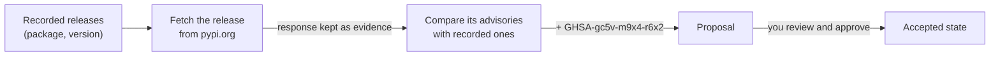

# Quickstart

Your team runs three Python services. Which release of each library they pin,
and which security advisories affect those releases, decides what can ship,
and people and agents act on it every day. In this quickstart, Cruxible holds
that knowledge for the team:

- the services and their pins, as typed state your editor checks;
- a check against PyPI that brings back real advisories, as changes you review
  before they land;
- a repository doc, `docs/dependencies.md`, that is flagged and regenerated
  when what it summarizes changes;
- answers to "which services are affected, why, and what did we believe
  before?".

It takes about fifteen minutes and needs network access to pypi.org.

## Install and start

Requirements: Python 3.11+ and Git.

~~~bash
pip install cruxible        # or: uv tool install cruxible
~~~

Cruxible runs as a background server, the daemon. Start it in its own shell
and leave it running:

~~~bash
cruxible server start --socket ~/.cruxible/run/daemon.sock
~~~

## Create a workspace

The knowledge lives next to the code it describes, in a Git repository. In a
second shell:

~~~bash
mkdir services && cd services && git init
export CRUXIBLE_SERVER_SOCKET=~/.cruxible/run/daemon.sock
cruxible init
~~~

`init` creates an instance (one body of state on the daemon), makes you its
owner, and remembers the connection, so later commands, and Python, need no
flags.

## Install the vocabulary

Cruxible stores values only for fields it has a type for. This quickstart
needs a few: a service's owner and the releases it pins; a release's package,
version and advisories. You could define them yourself ([Modeling
state](modeling-state.md) shows how); to skip that here, install the demo kit,
which also carries the saved query and the PyPI check used below:

~~~bash
cruxible kit add quickstart:1.0.0
~~~

~~~text
quickstart 1.0.0: would_propose (install)
...
Preview at 500307c09f66; nothing was written.
Commit this change? [y/N]: y
~~~

It shows what it will add and asks first (`--yes` skips the question in
scripts). Now look at what you have:

~~~bash
cruxible orient
~~~

~~~text
Kinds (2):
  app.service  subjects=0
    depends_on  many  subject:pypi.release
    name  one  string
    owner  one  string
  pypi.release  subjects=0
    advisories  many  string
    name  one  string
    package  one  string
    version  one  string
~~~

There are two kinds of thing: services, and releases of PyPI packages. Each
thing is a **Subject**, named `kind/id`: `app.service/payments`,
`pypi.release/requests-2.32.4`. A service's `depends_on` points at the
releases it pins.

<!-- Maintainers: `orient` also prints each field's evidence contracts; they are
trimmed here. The kit's PyPI check (Line pypi.check_advisories, its Procedure,
and the cruxible-provider-web default it names) is not built yet: the kit add
output above, the Line run below, and the review and evidence outputs for the
Line's proposal were verified with an equivalent cited write instead. -->

## Record what the team knows

Write down the pins, as the services' `requirements.txt` files have them.
Save this as `seed.py` and run it with `python seed.py`:

~~~python
from cruxible_client import Cruxible

PINS = {
    "payments": ("ada", "requests-2.32.4"),
    "billing": ("grace", "requests-2.32.4"),
    "search": ("linus", "jinja2-3.1.6"),
}

with Cruxible.connect() as cx:
    batch = cx.changes(because="Pins from each service's requirements.txt.")
    for release in {"requests-2.32.4", "jinja2-3.1.6"}:
        package, version = release.split("-")
        batch.set(f"pypi.release/{release}", "package", package)
        batch.set(f"pypi.release/{release}", "version", version)
    for service, (owner, release) in PINS.items():
        batch.set(f"app.service/{service}", "owner", owner)
        batch.add(f"app.service/{service}", "depends_on", f"pypi.release/{release}")
    outcome = batch.write()
    print(outcome.status, "at generation", outcome.coordinate.generation)
~~~

~~~text
accepted at generation 2
~~~

Every write says why (`because`), and the changes in one batch land together
or not at all. Each accepted change is a numbered **generation**, a point in
history you can read back later. Each value is stored as a **Claim**: the
value, the reason, and the evidence for it, with an ID (`CLM-…`).

Read it back:

~~~bash
cruxible query app.service --select owner,depends_on
~~~

~~~text
subject               owner  depends_on                    flags
app.service/billing   grace  pypi.release/requests-2.32.4  -
app.service/payments  ada    pypi.release/requests-2.32.4  -
app.service/search    linus  pypi.release/jinja2-3.1.6     -
~~~

Nobody has recorded any advisories yet. As far as the team knows, everything
is clear.

Your editor knows this vocabulary too. Cruxible keeps it as Python types in
`.cruxible/world.pyi`, current whenever the vocabulary changes. Put `.cruxible`
on your type checker's search path (for mypy, `MYPYPATH=.cruxible`), bind the
typed world once, and a misspelled field is caught before anything runs:

~~~python
world = cast("World", cx.world())
world.app.service["search"].set(ownr="grace", because="Grace took over search.")
~~~

~~~text
error: Unexpected keyword argument "ownr" for "set" of "_S_app__service"; did you mean "owner"?
~~~

## A doc that depends on it

The team keeps a dependencies page in the repository, where people and agents
read it. Write it with two marked passages: a summary you write, and a table
Cruxible fills in.

~~~bash
mkdir docs
cat > docs/dependencies.md <<'EOF'
# Dependencies

## Release status

<!-- cruxible:block:summary -->
All services are clear to release.
<!-- /cruxible:block:summary -->

## Services with known advisories

<!-- cruxible:block:exposed -->
<!-- /cruxible:block:exposed -->
EOF
cruxible sources add deps docs/dependencies.md
git add -A && git commit -m "Dependencies page"
~~~

`sources add` gives the file a name Cruxible can refer to. Now stamp both
passages with what they reflect, the kit's saved query
`app.exposed_services` (services pinning a release with a known advisory).
`--render` fills the table from it:

~~~bash
cruxible block repin deps exposed --query QueryDefinition:app.exposed_services --render
cruxible block repin deps summary --query QueryDefinition:app.exposed_services
~~~

~~~text
Repinned deps#exposed at generation 2.
Repinned deps#summary at generation 2.
~~~

Each marked passage is a **projection block**: it carries a stamp of the state
it reflects, so Cruxible can tell when it no longer does. Note the
generation, 2: you will read history at it later. The page now reads:

!!! example "docs/dependencies.md"

    **Release status**

    All services are clear to release.

    **Services with known advisories**

    _No rows._

## Check against PyPI

What the team believes is only as good as its last check. PyPI publishes the
known vulnerabilities of every release at
`https://pypi.org/pypi/<package>/<version>/json`. The kit carries a **Line**
that checks each recorded release there: a named job that runs a
**Procedure** (a fixed, checked sequence of steps) and turns what it finds
into proposed changes.

Run it now (a Line can also run on a schedule):

~~~bash
cruxible line run pypi.check_advisories
~~~

It changes nothing by itself. It leaves a **proposal**: a candidate change,
checked against the current state, waiting for approval. Review it:

~~~bash
cruxible proposal list --status open
cruxible proposal review PROPOSAL_ID
~~~

~~~text
Changes (1):
  set pypi.release/requests-2.32.4 advisories: GHSA-gc5v-m9x4-r6x2  [CLM-…]
~~~

PyPI lists one advisory against `requests 2.32.4` (fixed in 2.33.0) and none
against `jinja2 3.1.6`. Approve it. This signs it with the key `init` made for
you, and since yours is the approval it needs, the same command accepts it:

~~~bash
cruxible proposal approve PROPOSAL_ID --yes
~~~

~~~text
Approved sha256:… as YOUR_ID
Activated at 968bd94e8816…
~~~

Here you approve your own changes. An instance can instead require someone
else's approval, so the changes an agent or a Line proposes wait for a person.
(`--hold` signs without accepting, when someone else should decide when it
lands.)

## The doc is out of date

Ask what needs attention:

~~~bash
cruxible next
~~~

~~~text
warning  projection_backing_stale  deps#exposed  next=cruxible.block.repin
  repair: cruxible block repin deps exposed
warning  projection_backing_stale  deps#summary  next=cruxible.block.repin
  repair: cruxible block repin deps summary
~~~

`next` is the to-do list for this instance: everything wrong or waiting, each
with the command that fixes it. Both passages of the page reflect state that
has moved. The table is generated, so Cruxible regenerates it:

~~~bash
cruxible block sync --all
~~~

~~~text
docs/dependencies.md#exposed: rendered
docs/dependencies.md#summary: stale:block_backing_changed
~~~

The summary is your prose, so Cruxible only flags it. The page now contradicts
itself:

!!! warning "docs/dependencies.md, summary out of date"

    **Release status**

    All services are clear to release.

    **Services with known advisories**

    | subject | advisories | owner | release |
    |---|---|---|---|
    | Subject:app.service/billing | ["GHSA-gc5v-m9x4-r6x2"] | grace | requests-2.32.4 |
    | Subject:app.service/payments | ["GHSA-gc5v-m9x4-r6x2"] | ada | requests-2.32.4 |

Rewrite the summary (you, or an agent):

~~~markdown
<!-- cruxible:block:summary:ref:… -->
Hold payments and billing: requests 2.32.4 has GHSA-gc5v-m9x4-r6x2 (fixed in 2.33.0).
search is clear to release.
<!-- /cruxible:block:summary -->
~~~

and restamp it, which is you declaring the text right again:

~~~bash
cruxible block repin deps summary
cruxible next
~~~

~~~text
Repinned deps#summary at generation 3.
No repair work in the observed domains.
~~~

## Fix and recheck

The payments team upgrades to `requests 2.33.0`. Record the new pin through
the typed world. Save as `bump.py`:

~~~python
from typing import TYPE_CHECKING, cast

from cruxible_client import Cruxible

if TYPE_CHECKING:
    from world import World

with Cruxible.connect() as cx:
    world = cast("World", cx.world())
    (old,) = world.app.service["payments"].depends_on
    batch = cx.changes(because="payments now pins requests 2.33.0.")
    batch.set("pypi.release/requests-2.33.0", "package", "requests")
    batch.set("pypi.release/requests-2.33.0", "version", "2.33.0")
    batch.retire(old.claim)
    batch.add("app.service/payments", "depends_on", "pypi.release/requests-2.33.0")
    outcome = batch.write()
    print(outcome.status, "at generation", outcome.coordinate.generation)
~~~

`depends_on` holds the payments pin as a Claim; `retire` ends it and `add`
records the new one, in one change. Then check the new release against PyPI:

~~~bash
python bump.py
cruxible line run pypi.check_advisories
~~~

PyPI lists no advisories for `requests 2.33.0`, so the check proposes nothing.
Regenerate the page and update the summary as before (`block sync --all`,
edit, `block repin deps summary`):

!!! success "docs/dependencies.md"

    **Release status**

    Hold billing: requests 2.32.4 has GHSA-gc5v-m9x4-r6x2 (fixed in 2.33.0).
    payments and search are clear to release.

    **Services with known advisories**

    | subject | advisories | owner | release |
    |---|---|---|---|
    | Subject:app.service/billing | ["GHSA-gc5v-m9x4-r6x2"] | grace | requests-2.32.4 |

## Ask the state directly

The table in the page is a saved query, written into the repository. You can
ask the state the same question, or a new one, directly:

~~~bash
cruxible query --name app.exposed_services
cruxible query app.service --follow depends_on:release --select owner,release.version,release.advisories
~~~

~~~text
subject              advisories           owner  release          flags
app.service/billing  GHSA-gc5v-m9x4-r6x2  grace  requests-2.32.4  -

subject               owner  release.version  release.advisories   flags
app.service/billing   grace  2.32.4           GHSA-gc5v-m9x4-r6x2  -
app.service/payments  ada    2.33.0           -                    -
app.service/search    linus  3.1.6            -                    -
~~~

The second follows each service's `depends_on` to its release. Nobody wrote
"billing is affected": it follows from one advisory and the pins you recorded,
and it answers the same way every time. In Python, `cx.query(name=...)` returns
the same rows.

Ask the advisory why it is there, by the `CLM-…` ID the review printed:

~~~bash
cruxible get CLAIM_ID --detail evidence
~~~

~~~text
value: GHSA-gc5v-m9x4-r6x2
capture CAP-1fec8823b8ae  ...  observed=2026-10-15T14:27:35Z  evidence admitted
rationale: PyPI lists GHSA-gc5v-m9x4-r6x2 against requests 2.32.4 (fixed in 2.33.0).
~~~

It rests on the PyPI response, kept as evidence when the check fetched it.

## What we believed before

Every generation stays readable. Ask the same question at generation 2, when
the page was first stamped:

~~~bash
cruxible query app.service --follow depends_on:release --select owner,release.version,release.advisories --at 2
~~~

~~~text
subject               owner  release.version  release.advisories  flags
app.service/billing   grace  2.32.4           -                   -
app.service/payments  ada    2.32.4           -                   -
app.service/search    linus  3.1.6            -                   -
~~~

Then, both payments and billing pinned `requests 2.32.4`, and nobody knew of
an advisory against it.

## Next

- [Modeling state](modeling-state.md): define your own kinds and fields.
- [Concepts](concepts.md): the model behind what you just did.
- [For AI agents](for-ai-agents.md): connect an agent over MCP or the Python
  SDK, and give it propose-only access.
- [Projection blocks](declared-blocks.md): stamped passages and generated
  tables in your docs.
- [Kits](kits.md): install vocabulary, queries and Lines someone else built,
  or build your own.
- [CLI reference](cli-reference.md).
