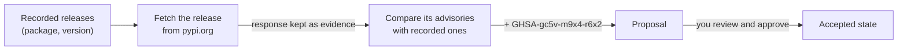

# Quickstart

Welcome! In this walkthrough, we'll use Cruxible to look after the
dependencies of a small engineering team. The team runs three Python services,
`payments`, `billing` and `search`, and each pins a release of a library from
PyPI. Together, we'll use Cruxible to:

1. record which release each service pins, as typed knowledge that every
   change is checked against;
2. check those releases against PyPI for security advisories, and review what
   comes back before it is accepted;
3. keep a page in the team's repository, `docs/dependencies.md`, in step with
   what we know, so nobody (person or agent) reads a stale answer.

We'll do it all with the `cruxible` Python package and its command line. By
the end, you'll know how to:

- describe a domain to Cruxible, and record what you know with the reason you
  know it;
- bring facts in from the outside world, and approve changes before they land;
- tie your docs to your knowledge, so Cruxible tells you when they go stale;
- ask questions of what you know, trace any answer to its evidence, and see
  what you believed at any earlier point.

It takes about twenty minutes, and needs Python 3.11+, Git, and network access
to pypi.org.

## Step 1: Install and start Cruxible

Install the package:

~~~bash
pip install cruxible        # or: uv tool install cruxible
~~~

Cruxible keeps your knowledge in a small background server called the
**daemon**. Every command you run, and every agent you connect later, talks to
it. Start it in its own terminal and leave it running:

~~~bash
cruxible server start --socket ~/.cruxible/run/daemon.sock
~~~

## Step 2: Create a workspace

Knowledge is most useful next to the work it describes, so Cruxible attaches
to a Git repository. Open a second terminal and make one for the team:

~~~bash
mkdir services && cd services && git init
export CRUXIBLE_SERVER_SOCKET=~/.cruxible/run/daemon.sock
cruxible init
~~~

`init` creates an **instance**, the team's own body of knowledge on the
daemon, makes you its owner, and remembers the connection. From here on,
commands in this folder need no extra flags.

## Step 3: Describe the domain

Before Cruxible can hold anything, it needs to know what kinds of things exist
and what can be said about them. This is the **vocabulary**. For our team we
need two kinds of thing, with a few fields each:

- a **service** has an owner, and depends on one or more releases;
- a **release** of a PyPI package has a package name, a version, and any
  security advisories published against it.

You can define a vocabulary yourself ([Modeling state](modeling-state.md)
shows how). To get to the interesting part sooner, we'll install a ready-made
one as a **kit**, which also carries a saved question and the PyPI check we'll
use later:

~~~bash
cruxible kit add quickstart:1.0.0
~~~

~~~text
quickstart 1.0.0: would_propose (install)
...
Preview at 500307c09f66; nothing was written.
Commit this change? [y/N]: y
~~~

Cruxible showed you what the kit would add and waited for your yes. You'll
see this habit again: changes are shown before they land. Now ask Cruxible
what it knows about:

~~~bash
cruxible orient
~~~

~~~text
Kinds (2):
  app.service  subjects=0
    depends_on  many  subject:pypi.release
    name  one  string
    owner  one  string
  pypi.release  subjects=0
    advisories  many  string
    name  one  string
    package  one  string
    version  one  string
~~~

Each thing Cruxible tracks is a **Subject**, named `kind/id`: the payments
service will be `app.service/payments`, and requests 2.32.4 will be
`pypi.release/requests-2.32.4`. The fields say what each can hold: one owner,
any number of advisories, and `depends_on`, which points from a service to the
releases it pins.

<!-- Maintainers: `orient` also prints each field's evidence contracts; they are
trimmed here. The kit's PyPI check (Line pypi.check_advisories, its Procedure,
and the cruxible-provider-web default it names) is not built yet: the kit add
output above, the Line run below, and the review and evidence outputs for the
Line's proposal were verified with an equivalent cited write instead. -->

## Step 4: Record what the team knows

Now let's write down what the team knows today: which release each service
pins, taken from their `requirements.txt` files. We'll keep it in a file in
the repository, `pins.yaml`, so the starting point is itself under version
control:

~~~yaml
because: Pins from each service's requirements.txt.
changes:
  - {op: set, subject: pypi.release/requests-2.32.4, field: package, value: requests}
  - {op: set, subject: pypi.release/requests-2.32.4, field: version, value: "2.32.4"}
  - {op: set, subject: pypi.release/jinja2-3.1.6, field: package, value: jinja2}
  - {op: set, subject: pypi.release/jinja2-3.1.6, field: version, value: "3.1.6"}
  - {op: set, subject: app.service/payments, field: owner, value: ada}
  - {op: add, subject: app.service/payments, field: depends_on, value: pypi.release/requests-2.32.4}
  - {op: set, subject: app.service/billing, field: owner, value: grace}
  - {op: add, subject: app.service/billing, field: depends_on, value: pypi.release/requests-2.32.4}
  - {op: set, subject: app.service/search, field: owner, value: linus}
  - {op: add, subject: app.service/search, field: depends_on, value: pypi.release/jinja2-3.1.6}
~~~

Each line is one change: `set` gives a field its value, and `add` adds one
more value to a field that can hold several. Apply them all at once:

~~~bash
cruxible write pins.yaml
~~~

~~~text
accepted (generation 2, 698616d82fe7)
  set pypi.release/requests-2.32.4 package: requests  [CLM-…; verdict supported]
  ...
  add app.service/search depends_on: pypi.release/jinja2-3.1.6  [CLM-…; verdict supported]
  + subject pypi.release/requests-2.32.4
  ...
~~~

A few fundamentals are hiding in that output:

- **Every value is a Claim.** Cruxible doesn't store bare values; it stores
  the value together with the reason you gave (`because`) and the evidence
  behind it. Each Claim has an ID (`CLM-…`), so you can always ask about it
  later. Here the evidence is your own word; in Step 6 it will be a response
  from PyPI.
- **A write lands whole or not at all.** All ten changes were accepted
  together. Things the write mentioned that didn't exist yet, like the
  services themselves, were created along the way (`+ subject`).
- **Every accepted change is a generation.** Generations are numbered points
  in history. This is generation 2, and we'll come back to it at the end.

Read back what you recorded:

~~~bash
cruxible query app.service --select owner,depends_on
~~~

~~~text
subject               owner  depends_on                    flags
app.service/billing   grace  pypi.release/requests-2.32.4  -
app.service/payments  ada    pypi.release/requests-2.32.4  -
app.service/search    linus  pypi.release/jinja2-3.1.6     -
~~~

Nobody has recorded any advisories yet, so as far as the team knows,
everything is clear to release.

Because Cruxible knows the vocabulary, it checks every write against it before
anything lands. Try a typo:

~~~bash
cruxible set app.service/search ownr grace --because "Grace took over search."
~~~

~~~text
refused (generation 2, 698616d82fe7)
cruxible.write.unknown_field (change 0): app.service has no field 'ownr'
  nearest: owner, app.service.owner
~~~

The write was refused, nothing changed, and Cruxible suggested what you
probably meant. Agents get the same checks through MCP and the Python SDK,
where the vocabulary also comes as Python types for their editors and type
checkers ([For AI agents](for-ai-agents.md)).

## Step 5: Tie a doc to what you know

Knowledge is mostly read in documents, not databases, and a doc that quietly
goes out of date is worse than none. Let's write the team's dependencies page
and tie it to what Cruxible knows. It has two marked passages: a summary we
write ourselves, and a table Cruxible will fill in.

~~~bash
mkdir docs
cat > docs/dependencies.md <<'EOF'
# Dependencies

## Release status

<!-- cruxible:block:summary -->
All services are clear to release.
<!-- /cruxible:block:summary -->

## Services with known advisories

<!-- cruxible:block:exposed -->
<!-- /cruxible:block:exposed -->
EOF
cruxible files add deps docs/dependencies.md
git add -A && git commit -m "Pins and dependencies page"
~~~

`files add` gives the page a name, `deps`, that Cruxible can refer to. Both
passages depend on the same question, the kit's saved query
`app.exposed_services`: *which services pin a release with a known advisory?*
Stamp each passage with that question. `--render` also fills the table in
from the answer:

~~~bash
cruxible block repin deps exposed --query QueryDefinition:app.exposed_services --render
cruxible block repin deps summary --query QueryDefinition:app.exposed_services
~~~

~~~text
Repinned deps#exposed at generation 2.
Repinned deps#summary at generation 2.
~~~

Each marked passage is now a **projection block**: it records exactly which
state it reflects, so Cruxible can tell when that state moves on. Rendered,
the page reads:

!!! example "docs/dependencies.md"

    **Release status**

    All services are clear to release.

    **Services with known advisories**

    _No rows._

## Step 6: Bring in facts from the outside world

What the team believes is only as good as its last check. PyPI publishes the
known vulnerabilities of every release at
`https://pypi.org/pypi/<package>/<version>/json`, so let's ask it.

Cruxible goes out to the world through **Lines**. A Line is a named job that
runs a **Procedure**, a fixed and checked sequence of steps, and turns what it
finds into proposed changes. The kit's Line, `pypi.check_advisories`, works
like this:

Run it once now (Lines can also run on a schedule):

~~~bash
cruxible line run pypi.check_advisories
~~~

Notice that the run doesn't change what the team knows. Anything it found
waits as a **proposal**: a candidate change, already checked against the
current state, that needs someone's approval. Let's see what it found:

~~~bash
cruxible proposal list --status open
cruxible proposal review PROPOSAL_ID
~~~

~~~text
Changes (1):
  set pypi.release/requests-2.32.4 advisories: GHSA-gc5v-m9x4-r6x2  [CLM-…]
~~~

PyPI lists one advisory against `requests 2.32.4`, fixed in 2.33.0, and none
against `jinja2 3.1.6`. That looks right, so approve it:

~~~bash
cruxible proposal approve PROPOSAL_ID --yes
~~~

~~~text
Approved sha256:… as YOUR_ID
Activated at 968bd94e8816…
~~~

Approving signs the proposal with the key `init` made for you. Since yours is
the only approval it needs, the same command accepts it. On a real team you'd
usually require someone else's approval instead, so the changes an agent or a
Line proposes wait for a person. (`--hold` signs without accepting, for when
someone else should decide when it lands.)

## Step 7: Keep the doc honest

Our knowledge just changed, but `docs/dependencies.md` still says everything
is clear. Ask Cruxible what needs attention:

~~~bash
cruxible next
~~~

~~~text
warning  projection_backing_stale  deps#exposed  next=cruxible.block.repin
  repair: cruxible block repin deps exposed
warning  projection_backing_stale  deps#summary  next=cruxible.block.repin
  repair: cruxible block repin deps summary
~~~

`next` is your to-do list: everything that is wrong or waiting, each with the
command that fixes it. Both passages of the page reflect a state that has
moved on. The table is generated from the saved question, so Cruxible can
regenerate it for you:

~~~bash
cruxible block sync --all
~~~

~~~text
docs/dependencies.md#exposed: rendered
docs/dependencies.md#summary: stale:block_backing_changed
~~~

The summary is your writing, so Cruxible flags it but never rewrites it. Look
at the page now. The table is current, and the summary contradicts it:

!!! warning "docs/dependencies.md, summary out of date"

    **Release status**

    All services are clear to release.

    **Services with known advisories**

    | subject | advisories | owner | release |
    |---|---|---|---|
    | app.service/billing | GHSA-gc5v-m9x4-r6x2 | grace | requests-2.32.4 |
    | app.service/payments | GHSA-gc5v-m9x4-r6x2 | ada | requests-2.32.4 |

Rewrite the summary, as you or an agent would:

~~~markdown
<!-- cruxible:block:summary:ref:… -->
Hold payments and billing: requests 2.32.4 has GHSA-gc5v-m9x4-r6x2 (fixed in 2.33.0).
search is clear to release.
<!-- /cruxible:block:summary -->
~~~

Then stamp it again. Restamping is you declaring that the text is right for
the current state:

~~~bash
cruxible block repin deps summary
cruxible next
~~~

~~~text
Repinned deps#summary at generation 3.
No repair work in the observed domains.
~~~

## Step 8: Fix it and check again

The payments team upgrades to `requests 2.33.0`. Let's record the new release
and move payments' pin to it. Both belong together, so they go in one write:

~~~bash
cruxible write - <<'EOF'
because: payments now pins requests 2.33.0.
changes:
  - {op: set, subject: pypi.release/requests-2.33.0, field: package, value: requests}
  - {op: set, subject: pypi.release/requests-2.33.0, field: version, value: "2.33.0"}
  - {op: retire, target: {subject: app.service/payments, field: depends_on, value: pypi.release/requests-2.32.4}}
  - {op: add, subject: app.service/payments, field: depends_on, value: pypi.release/requests-2.33.0}
EOF
~~~

~~~text
accepted (generation 4, 51e0d8ab74a5)
  ...
  retire app.service/payments depends_on: pypi.release/requests-2.32.4  [CLM-…]
  add app.service/payments depends_on: pypi.release/requests-2.33.0  [CLM-…; verdict supported]
  + subject pypi.release/requests-2.33.0
~~~

`retire` ends a Claim without erasing it: the old pin is no longer current,
but it stays in history. (On its own, that's `cruxible retire
app.service/payments depends_on pypi.release/requests-2.32.4 --because "…"`.)

A release nobody has checked isn't known to be clean, so run the check
again:

~~~bash
cruxible line run pypi.check_advisories
~~~

PyPI lists no advisories for `requests 2.33.0`, so this time the check
proposes nothing. Bring the page up to date the same way as before: run
`cruxible block sync --all`, rewrite the summary, and restamp it.

!!! success "docs/dependencies.md"

    **Release status**

    Hold billing: requests 2.32.4 has GHSA-gc5v-m9x4-r6x2 (fixed in 2.33.0).
    payments and search are clear to release.

    **Services with known advisories**

    | subject | advisories | owner | release |
    |---|---|---|---|
    | app.service/billing | GHSA-gc5v-m9x4-r6x2 | grace | requests-2.32.4 |

## Step 9: Ask questions and trace the answers

The table in the page is one saved question, written into the repository for
people and agents to read. You can also ask Cruxible directly, with the saved
question or a new one:

~~~bash
cruxible query --name app.exposed_services
cruxible query app.service --follow depends_on:release --select owner,release.version,release.advisories
~~~

~~~text
subject              advisories           owner  release          flags
app.service/billing  GHSA-gc5v-m9x4-r6x2  grace  requests-2.32.4  -

subject               owner  release.version  release.advisories   flags
app.service/billing   grace  2.32.4           GHSA-gc5v-m9x4-r6x2  -
app.service/payments  ada    2.33.0           -                    -
app.service/search    linus  3.1.6            -                    -
~~~

The second query follows each service's `depends_on` to the release it pins.
Notice that nobody ever wrote "billing is affected". It follows from one
advisory and the pins you recorded, and Cruxible gives the same answer every
time. Agents ask the same questions through MCP or the SDK.

Every answer can be traced back. Ask the advisory's Claim why it's there,
using the `CLM-…` ID from the review in Step 6:

~~~bash
cruxible get CLAIM_ID --detail evidence
~~~

~~~text
value: GHSA-gc5v-m9x4-r6x2
capture CAP-1fec8823b8ae  ...  observed=2026-10-15T14:27:35Z  evidence: admitted
rationale: PyPI lists GHSA-gc5v-m9x4-r6x2 against requests 2.32.4 (fixed in 2.33.0).
~~~

It rests on PyPI's own response, which was kept as evidence when the check
fetched it.

## Step 10: Look back in time

Remember generation 2, when we first recorded the pins? Every generation stays
readable, so you can ask the same question as of then:

~~~bash
cruxible query app.service --follow depends_on:release --select owner,release.version,release.advisories --at 2
~~~

~~~text
subject               owner  release.version  release.advisories  flags
app.service/billing   grace  2.32.4           -                   -
app.service/payments  ada    2.32.4           -                   -
app.service/search    linus  3.1.6            -                   -
~~~

Back then, payments and billing both pinned `requests 2.32.4`, and nobody
knew of an advisory against it. When someone asks "what did we know, and
when?", this is how you answer.

## What you've learned

In twenty minutes, you've used the core of Cruxible:

- a **vocabulary** of kinds and fields, and **Claims** that record each value
  with its reason and evidence;
- **writes** that are checked before they land, and **generations** that keep
  every earlier state readable;
- **Lines** that bring facts in from the outside world as **proposals** you
  review and approve;
- **projection blocks** that tie your docs to your knowledge, and `next`,
  which tells you what needs attention;
- **queries** that answer questions over everything you know, with every
  answer traceable to its evidence.

## Where to go next

- [Modeling state](modeling-state.md): define a vocabulary for your own
  domain.
- [Concepts](concepts.md): the model behind what you just did.
- [For AI agents](for-ai-agents.md): connect an agent over MCP or the Python
  SDK, and give it propose-only access.
- [Projection blocks](declared-blocks.md): more on tying docs to state.
- [Kits](kits.md): install vocabularies, queries and Lines someone else built,
  or package your own.
- [CLI reference](cli-reference.md).
