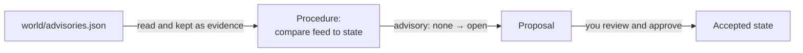

# Quickstart

Cruxible keeps facts about things you care about, with the reason and the
evidence for each one, and notices when something that depends on a fact has
to change. In about ten minutes you will:

- record which services use which libraries, with typed values your editor checks;
- watch a change in the outside world arrive as a proposal you review before it lands;
- see a status page you wrote get flagged as out of date;
- ask which services the change reaches, why, and what the answer was before.

## Install and start

Requirements: Python 3.11+ and Git.

~~~bash
pip install cruxible        # or: uv tool install cruxible
~~~

Cruxible runs as a small background server, the daemon, that keeps your
state. Start it in its own shell:

~~~bash
cruxible server start --socket ~/.cruxible/run/daemon.sock
~~~

It stores everything under `~/.cruxible`. Leave it running.

## Create a workspace

State lives next to the work it describes, in a Git repository. In a second
shell:

~~~bash
mkdir services && cd services && git init
export CRUXIBLE_SERVER_SOCKET=~/.cruxible/run/daemon.sock
cruxible init
~~~

`init` creates an instance (one body of state on the daemon), makes you its
owner, and remembers the connection, so later commands, and Python, need no
flags.

## Install the vocabulary

Cruxible only stores values it has a type for. The types come as a kit, a
release of definitions you install in one step. This one describes libraries
and the services that depend on them:

~~~bash
cruxible kit add quickstart:1.0.0
~~~

~~~text
quickstart 1.0.0: would_propose (install)
...
Preview at 34a7d27b72b7; nothing was written.
Commit it: rerun the same command with --commit --at 34a7d27b72b7
~~~

Run the command it prints (`cruxible kit add quickstart:1.0.0 --commit --at
<oid>`), then look at what you have:

~~~bash
cruxible orient
~~~

~~~text
Kinds (2):
  app.library  subjects=0
    advisory  one  enum[none|open|fixed]
    latest  one  string
    name  one  string
  app.service  subjects=0
    depends_on  many  subject:app.library
    name  one  string
    owner  one  string
Queries:
  app.exposed_services()  Services that depend on a library with an open advisory.
~~~

There are two kinds of thing, `app.library` and `app.service`. Each thing is
a **Subject**, named `kind/id`, like `app.service/payments`. Each kind has
fields: `advisory` holds exactly one of `none`, `open` or `fixed`;
`depends_on` holds any number of libraries. The kit also brought one saved
query, used later.

## Write state

Generate Python types for this vocabulary, so your editor knows every kind,
field and allowed value:

~~~bash
cruxible stub --out world.pyi
~~~

Then record the inventory. Save this as `seed.py` and run it with `python
seed.py`:

~~~python
from cruxible_client import Cruxible

with Cruxible.connect() as cx:
    batch = cx.changes(because="Inventory from the team wiki.")
    batch.set("app.library/libfoo", "advisory", "none")
    batch.set("app.library/libbar", "advisory", "none")
    for service, owner, library in [
        ("payments", "ada", "libfoo"),
        ("billing", "grace", "libfoo"),
        ("search", "linus", "libbar"),
    ]:
        batch.set(f"app.service/{service}", "owner", owner)
        batch.add(f"app.service/{service}", "depends_on", f"app.library/{library}")
    outcome = batch.write()
    print(outcome.status, "at generation", outcome.coordinate.generation)
~~~

~~~text
accepted at generation 2
~~~

Every write says why (`because`). The changes in one batch land together or
not at all, and each accepted change is a numbered **generation**: a point in
history you can read back later. Each value is stored as a **Claim**: the
value, the reason, and the evidence behind it, with an ID (`CLM-…`).

Read it back:

~~~bash
cruxible query app.service --select owner,depends_on
~~~

~~~text
subject               owner  depends_on          flags
app.service/billing   grace  app.library/libfoo  -
app.service/payments  ada    app.library/libfoo  -
app.service/search    linus  app.library/libbar  -
~~~

## Typed edits

Once a thing exists, edit it through the typed world. Save as `update.py`:

~~~python
from typing import TYPE_CHECKING, cast

from cruxible_client import Cruxible

if TYPE_CHECKING:
    from world import World

with Cruxible.connect() as cx:
    world = cast("World", cx.world())
    libfoo = world.app.library["libfoo"]
    libfoo.set(latest="2.2", because="Read off the libfoo releases page.")
    libfoo.set(advisory="opne", because="A typo.")
~~~

Your editor completes `app.library`, `latest` and `advisory`, and a type
checker rejects the typo before anything runs:

~~~text
update.py:12: error: Argument "advisory" to "set" of "_S_app__library" has incompatible
type "Literal['opne']"; expected "Literal['none', 'open', 'fixed']"
~~~

Run it anyway, and the daemon refuses the bad write with the nearest valid
value. Nothing lands; the first `set` already did:

~~~text
WriteRefusalError: cruxible.write.value_not_member: 'opne' is not a member of advisory;
its members are: none, open, fixed (at changes[0].value); nearest: open, none.
~~~

## A page that depends on state

Teams write summaries of state: status pages, release notes, runbooks. Write
one, and mark the passage that depends on state:

~~~bash
mkdir world
printf '{\n  "libbar": {"advisory": "none"},\n  "libfoo": {"advisory": "none"}\n}\n' > world/advisories.json
cat > STATUS.md <<'EOF'
# Release status

<!-- cruxible:block:release -->
All services are clear to release.
<!-- /cruxible:block:release -->
EOF
~~~

`world/advisories.json` stands in for an outside source, like a security
advisory feed. List both files in `.cruxible/sources.yaml`, so Cruxible can
refer to them by name, and commit:

~~~bash
cat > .cruxible/sources.yaml <<'EOF'
catalog_kind: portable
entries:
  - name: advisories
    locator: world/advisories.json
  - name: status
    locator: STATUS.md
EOF
git add -A && git commit -m "Status page and advisory feed"
~~~

Now stamp the passage with what it summarizes, the saved query
`app.exposed_services`:

~~~bash
cruxible block repin status release --query QueryDefinition:app.exposed_services
~~~

~~~text
Repinned status#release at generation 3.
~~~

The marker now carries a stamp of the state the prose reflects. Note the
generation, 3: you will read history at it later. A stamped passage is a
**projection block**: prose you own, which Cruxible checks but never edits.

## The world changes

The feed now lists an advisory against `libfoo`:

~~~bash
printf '{\n  "libbar": {"advisory": "none"},\n  "libfoo": {"advisory": "open", "id": "GHSA-2026-0042", "fixed_in": "2.3"}\n}\n' > world/advisories.json
git commit -am "Advisory feed: libfoo GHSA-2026-0042"
~~~

The kit carries a **Line** that watches the feed: a named job that runs a
**Procedure** (a fixed, checked sequence of steps) and turns what it finds
into proposed changes:

Run it once now (Lines can also run on a schedule or when a file changes):

~~~bash
cruxible line run app.watch_advisories
~~~

<!-- Maintainers: the Line run's own output, and its proposal's Why: text, are
pending the quickstart kit's Procedure. The outputs below were verified with the
equivalent cited write (`cruxible set ... --evidence-file ... --no-accept`). -->

The run does not change state by itself. It leaves a **proposal**: a
candidate change, checked against current state, that waits for approval.

~~~bash
cruxible proposal list --status open
cruxible proposal review PROPOSAL_ID
~~~

~~~text
Changes (1):
  set app.library/libfoo advisory: none -> open  [CLM-…]
~~~

Approve it (this signs it with the key `init` made for you) and accept it:

~~~bash
cruxible proposal approve PROPOSAL_ID --yes
cruxible proposal activate PROPOSAL_ID
~~~

~~~text
accepted (9ebcfcaee5f2) by YOUR_ID
next: cruxible next
~~~

Here you approve your own changes. An instance can instead require someone
else's approval, so an agent's proposals wait for a person.

## Out-of-date pages are flagged

Ask what needs attention:

~~~bash
cruxible next
~~~

~~~text
warning  projection_backing_stale  status#release  next=cruxible.block.repin
  repair: cruxible block repin status release
~~~

The status page still says everything is clear, and the state it summarizes
has moved. `next` is the to-do list for this instance: everything wrong or
waiting, each with the command that fixes it. Rewrite the passage (you, or an
agent):

~~~markdown
<!-- cruxible:block:release:ref:… -->
Hold payments and billing: libfoo has an open advisory (GHSA-2026-0042).
search is clear to release.
<!-- /cruxible:block:release -->
~~~

and restamp it:

~~~bash
cruxible block repin status release
cruxible next
~~~

~~~text
Repinned status#release at generation 4.
No repair work in the observed domains.
~~~

## What the change reaches

The saved query follows each service's `depends_on` to its library and keeps
the services whose library has an open advisory:

~~~bash
cruxible query --name app.exposed_services
~~~

~~~text
subject               library  owner  flags
app.service/billing   libfoo   grace  -
app.service/payments  libfoo   ada    -
~~~

Nobody wrote "billing is exposed". It follows from one changed value and the
relations you recorded, and it answers the same way every time. The same
question without saving it first:

~~~bash
cruxible query app.service --follow depends_on:lib --select owner,lib.advisory
~~~

Why does `libfoo` have an open advisory? Ask the Claim, by the `CLM-…` ID the
review printed:

~~~bash
cruxible get CLAIM_ID --detail evidence
~~~

~~~text
value: open
capture CAP-922df1bae414  ...  source=advisories  observed=2026-10-13T22:25:38Z  evidence admitted
rationale: The advisory feed lists GHSA-2026-0042 against libfoo.
~~~

The value rests on a passage of `world/advisories.json`, kept as evidence when
it was read.

## What we believed before

Every generation stays readable. Ask the same question at generation 3, when
the status page was first stamped:

~~~bash
cruxible query --name app.exposed_services --at 3
~~~

~~~text
library  owner
(no rows)
~~~

And see each value a Claim has held, when, and by whom:

~~~bash
cruxible get CLAIM_ID --detail history
~~~

~~~text
rev 2  seq 4 at 9ebcfcaee5f2  2026-10-13T22:25:38Z  by YOUR_ID  = open
rev 1  seq 2 at 91b2b27d8348  2026-10-13T22:25:02Z  by YOUR_ID  = none
~~~

## Next

- [Concepts](concepts.md): the model behind what you just did.
- [Modeling state](modeling-state.md): what to make a Subject, a field, or a
  file, for your own domain.
- [For AI agents](for-ai-agents.md): connect an agent over MCP or the Python
  SDK, and give it propose-only access.
- [Projection blocks](declared-blocks.md): stamped passages and generated
  tables in your pages.
- [Kits](kits.md): install vocabulary, queries and Procedures someone else
  built, or build your own.
- [CLI reference](cli-reference.md).
