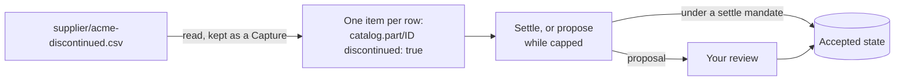

<!-- Bundled from cruxible 0.5.1 docs/lines-and-automation.md. -->

# Lines and automation

Some upkeep is the same every time: re-reading a supplier's list of
discontinued parts, re-fetching a price that expires, checking a feed for
new notices. Nobody should have to remember to do it, and nobody should have
to trust a script that writes straight into what the team knows. In
Cruxible, a **Line** does that work. It runs a fixed, checked **Procedure**
on a schedule or when something lands. What it finds arrives the way anyone's
change does: as a proposal citing the evidence it read, reviewed under your
approval policy. It keeps doing that until it has earned the right to land
changes itself.

This guide covers the pieces of automation, one worked example from writing
the Line to letting it settle on its own, the inbox for findings a Line
can't decide, and recovering work the daemon missed. It uses the car parts
example from Concepts.

## The pieces

| Piece | What it is |
|---|---|
| **Procedure** | A fixed graph of steps: read accepted state, read a source (keeping what it read as a Capture), extract its records, and end by posting to the inbox, proposing a change or settling one. Each provider call goes through a slot that names a capability; a Line binds each slot to one exact provider build, so a run can be replayed and explained. |
| **Capability** | A named, versioned kind of call (`workspace.file@1`, `web.fetch@1`): its request Contract, its result Contract and its effect. A slot names one; any installed operation that serves it and fits can fill the slot. |
| **Line** | A Procedure with its inputs, its budgets and an authority ceiling (`max_authority`): `observe`, `propose` or `settle`. |
| **Trigger** | When a Line runs: a cron schedule, a cadence, a Capture landing, a window closing, or a generation being accepted. |
| **Mandate** | The grant that lets a Procedure propose, or settle within a scope. |
| **Enablement** | Your consent for a Line to run on its Triggers. |

A Procedure never reads the clock. Time enters only through Triggers, so
"every morning" is a cron Trigger, and the same run on the same inputs gives
the same result. Procedures are written once, as a typed `ProcedureSpec`
(or with the SDK's `Sequence` builder over it), or come ready-made in a kit.

## A worked example: discontinued parts

Acme publishes the part numbers it has discontinued, and the team keeps a copy
in the repository at `supplier/acme-discontinued.csv`, one part per row with
the reason Acme gives:

~~~text
part,reason
af-208,Replaced by af-210
wb-330,End of line
~~~

The Procedure `catalog.acme-discontinued` reads that file and records
`discontinued: true` for each part it lists, citing the file as it read it:



Its last step settles. While its Line is capped at `propose`, that same step
proposes instead, so one Procedure serves the Line before and after it
graduates.

### Write the Procedure

A Procedure is written once, in the one typed authoring form (a
`ProcedureSpec`), and submitted like any definition. Every Procedure has one
shape: read state, fetch through a provider, derive with a provider, extract
the records, and end in claims (with filter/dedupe narrowing before claims, and
inbox posts for an agent to act on). Computation lives in a provider derive,
never in Procedure syntax: authoring refuses guard, halt, select, repeat,
invoke, emit, project and the shape/join/aggregate/union/derive transforms with
`procedure_step_closed`, naming the step.

That order is the usual shape, not a rule. Cruxible checks the step kinds and the
data dependencies: a step may use only the outputs of steps before it that it
depends on. So a Procedure may fetch twice (a detail fetch keyed by the first),
chain derives, or read state late. A read whose parameters use only the run's
input, its params, literals and other such reads runs at admission and is part
of the run's identity. A read keyed by a fetch, derive or extract output (a
**late read**, say the memberships of the one inventory an SBOM names) runs
when that output is ready, against the same accepted state as the run's other
reads. It counts against the same read budget, its refusal refuses the run,
and the run receipt lists it under `late_reads`, apart from the admitted
inputs.

#### Declare what the file looks like

An extract never describes a document itself. The file's **CaptureKind** (a
CaptureContract) declares how its bytes decode and its **layout**: its header
fields and its named record sets, each with where its records are, the key
that names each record's Subject, a row Contract that types the record, and
the rule for each field. Every Procedure that reads the kind reads it through
that one declaration.

The row Contract comes first, as a change set (`row.json`):

~~~json
{
  "kind": "change_set",
  "rationale": "The row Contract for Acme's discontinued-parts file.",
  "members": [
    {
      "kind": "contract",
      "name": "catalog.discontinued-line",
      "version": 1,
      "description": "One line of Acme's discontinued-parts file: why the part was dropped.",
      "fields": {"reason": "string{max_len: 200}"}
    }
  ]
}
~~~

Then the kind, with its decoding and layout (`supplier-file.yaml`):

~~~yaml
name: catalog.acme-discontinued
shape: http_response
decoding:
  format: csv
  csv: {header: true}
  limits: {decoded_bytes: 1048576, depth: 4, records: 10000}
layout:
  records:
    parts:
      at: /*
      key:
        part: {at: part, type: "key_part<catalog.part:name>"}
      row: catalog.discontinued-line@1
      fields:
        reason: {at: reason}
~~~

~~~text
$ cruxible authoring submit row.json --brief
outcome: accepted
...
$ cruxible capture-contract propose --input supplier-file.yaml
admitted  sha256:6f108ce0…  verdict=candidate
landed: accepted at f5091acc7af1
~~~

A layout needs a `json` or `csv` decoding. A CSV record set is every data row
(`/*`) and declares no header fields or count; a JSON one names a path such as
`/vulnerabilities/*` and may declare `count_at`, the path of a count the
document states about itself, so a short read shows as incomplete. A field
rule takes `at`, and optionally `type`, `parse`, `project`, `canonicalize` and
`presence`.

A kind and its layout often take more than one change, because each change can
use only what is already accepted or arrives in the same change set: the row
Contract before the layout that names it, and a ClaimType whose evidence rule
names the kind after the kind. When the row Contract itself refers to that
ClaimType (an `enum_of` field, say), add the kind without a layout first, then
the vocabulary and the row Contract, then the layout as the kind's successor.
A successor may only add to a layout: new header fields, new record sets, new
optional row fields. Any other change is a new kind.

The field the Procedure writes, `catalog.part.discontinued`, admits Captures of
this kind as evidence; see [Evolving your
vocabulary](evolving-your-vocabulary.md#the-vocabulary-file) for adding it.

#### The Procedure itself

The SDK's `Sequence` is a thin builder over the spec: each step returns a
handle, and `handle["field"]` is a typed reference to one of its fields. This
one reads the file, extracts its `parts` records, and ends in a claims step
with one Claim per record (`item(...)` is the current record):

~~~python
from cruxible_client import Cruxible
from cruxible_client.authoring.procedures import Sequence, item

cx = Cruxible.connect()
procedure = Sequence(
    "catalog.acme-discontinued",
    params={"path": "string{min_len: 1, max_len: 256}"},
    # The slot names a capability. Cruxible serves workspace.file itself.
    slots={"read": {"capability": "workspace.file@1"}},
)
listing = procedure.call(
    "listing", slot="read", captures={"capture": "catalog.acme-discontinued"},
    input={"logical_source": "acme.discontinued", "relative_path": procedure.params["path"]},
)
parts = procedure.extract("parts", capture=listing["capture"], records="parts")
procedure.claims(
    ({"type": "catalog.part.discontinued", "value": True,
      "rationale": "Listed in Acme's discontinued-parts file."},),
    for_each=parts["records"],
    subject={"kind": "catalog.part", "key": {"name": item("key", "part")}},
)

cx.changes(rationale="The Acme discontinued-parts check.") \
    .procedure(definition=procedure).submit()
~~~

The pieces:

- **The slot** names the capability `workspace.file@1`: read one file from an
  authorized workspace and return its bytes as one Capture. Its request is
  `{logical_source, relative_path}` (plus an optional `workspace`, naming one
  authorized root when there are several), and its result is one field,
  `capture`. A slot names a capability, never a provider: `web.fetch@1` is a
  slot's capability, `cruxible-provider-web#web.fetch` is a binding.
- **The call** sends a request typed against the capability's request
  Contract. A value must fit the field it fills: `relative_path` is
  `string{min_len: 1, max_len: 1024}`, so a parameter typed `string`, or one
  whose pattern only implies a length, is refused
  (`procedure_operand_type_mismatch`); state the bounds. `captures` names the
  CaptureKind of each Capture field of the result.
- **The extract** names the Capture and a record set of its kind's layout;
  `header=[...]` selects header fields. It may also set `duplicates` and
  `only_keys`, and give a key part the layout types as a plain string a
  Subject key type (`key={"url": "key_part<my.page:url>"}`). Nothing else about
  the document is written here. When the Procedure is accepted, the extract
  pins the row Contract it read, so a kind whose layout grows later does not
  change what this Procedure extracts until it is accepted again.
- **The claims step** writes one Claim per record, keyed by the record's key.

A Procedure that ends in a claims step, or whose only effect is posting to the
inbox, returns nothing: it needs no `output` and no `returns`. Declare an
output (and what fills it, `returns`) only when the run's result is itself
something to read.

`procedure.spec()` is the exact spec every surface submits; `get` shows an
accepted Procedure in the same form, each typed reference rendered as its
`$...` text for review, with each slot's capability pinned by digest:

~~~text
$ cruxible get Procedure:catalog.acme-discontinued
{
  "procedure": "catalog.acme-discontinued",
  ...
  "slots": {
    "read": {
      "capability": {
        "name": "workspace.file",
        "version": 1,
        "digest": "sha256:bf3721f9…"
      }
    }
  },
  "steps": [
    ...
    {
      "extract": "parts",
      "capture": "$steps.listing.capture",
      "records": "parts"
    },
    ...
~~~

To read many files at once, use the capability `workspace.files@1` instead:
its request is `{logical_source, glob, max_files}` and its result one field,
`captures`, a list. Each component of the glob may use `*`, `?` and `[...]`;
`**` is not a pattern. Cruxible lists the matches, sorted by their real names, and
reads each one as an ordinary file read, so the list holds one Capture per
file, and an extract over it cites each record's own file. Hidden files match
only a pattern that starts with `.`. More matches than `max_files` (default
100, at most 1000) refuses the read before any file is read (`glob_over_cap`).
A file that cannot be read (a link, say) is left out and the list is
incomplete. A glob names only the files that exist now: an extract straight
over it never judges absence, so a file the glob no longer matches retires
nothing. Each file counts as one provider call against the run's budget.

### Write the Line, its Trigger and its mandate

A Line, its Triggers and its mandate are definitions like any other, so they
go in through authoring as one change set, saved here as `automation.json`:

~~~json
{
  "kind": "change_set",
  "rationale": "Check Acme's discontinued-parts list every morning; propose what it lists for review.",
  "members": [
    {
      "kind": "line",
      "name": "catalog.acme-discontinued",
      "procedure_name": "catalog.acme-discontinued",
      "acquisition": {"listing.capture": {"max_age": "P1D"}},
      "max_authority": "propose",
      "parameters": {"path": "supplier/acme-discontinued.csv"}
    },
    {
      "kind": "trigger",
      "name": "catalog.acme-discontinued-daily",
      "line_name": "catalog.acme-discontinued",
      "schedule": {"kind": "cron", "expression": "0 6 * * *"}
    },
    {
      "kind": "procedure_mandate",
      "name": "catalog.acme-discontinued-propose",
      "line_name": "catalog.acme-discontinued",
      "grants": "propose",
      "namespace": ["claims"],
      "valid_from": "2026-11-15T00:00:00Z",
      "expires_at": "2027-02-13T00:00:00Z"
    }
  ]
}
~~~

~~~text
$ cruxible authoring submit automation.json --brief
outcome: accepted
...
~~~

When the change set waits for review (`--no-accept`, or a policy that needs an
approval), `proposal review` shows each definition as it would stand:

~~~text
$ cruxible proposal review sha256:6ccb2eec…
...
Definitions (3):
  Line catalog.acme-discontinued: created
    procedure    catalog.acme-discontinued
    authority    propose
    binding      read -> cruxible-builtin#workspace.file
    parameter    path = supplier/acme-discontinued.csv
    acquisition  listing.capture: (no origins)
    budget       max_capture_bytes=1048576  max_items=5000  max_provider_calls=100  max_wall_clock_microseconds=60000000
  ProcedureMandate catalog.acme-discontinued-propose: created
    line       catalog.acme-discontinued
    grants     propose
    valid      2026-11-15T00:00:00Z .. 2027-02-13T00:00:00Z
    namespace  claims
  Trigger catalog.acme-discontinued-daily: created
    schedule  on cron 0 6 * * * (UTC)
    target    Line:catalog.acme-discontinued
~~~

The Line's `parameters` are the Procedure's `params`: a Line run's input is
empty, so a value a Line supplies is declared as a param, never as `input`
(`line_parameters_refused` otherwise). Accepting the Line binds its slot: core
seeks the operations that serve the slot's capability and fit it, and records
the one it found (here the built-in `workspace.file`) as the Line's binding.
`acquisition` sets the rules for each capture output, keyed `<call>.<field>`
(how old a reading may be, and what to do when one is unavailable, stale or
oversized); an output left out runs under the core default: any age, refuse
when unavailable, stale or oversized. A mandate's `line_name` names the Line
it authorizes. Cron schedules are always UTC: 06:00 UTC, here. `cruxible
authoring example line`, `trigger` and `procedure-mandate` print templates.

### Run it once

`line run` runs the Line now, whether or not it's enabled:

~~~text
$ cruxible line run catalog.acme-discontinued
RUN-9048e6f5…: succeeded
Counts: written 2 (settled 0, proposed 2); unchanged 0; refused 0; inbox 0
Result: {}
Next: done
Read listing.capture: supplier/acme-discontinued.csv (57 bytes, sha256:f0905f48…)
Capture listing.capture: sha256:ca56e703…
Node listing call succeeded: 1 capture CAP-ca56e7030e1b
Node parts extract succeeded: 2 records
Node step_3 claims succeeded: 2 written; proposed
Proposal step_3: sha256:053ebd7f… candidate sha256:c854a7ba… (settle fell back: cruxible.settle.authority_capped_by_line_max_authority)
  2 items: 2 changed
  ...
~~~

Its Line is capped at `propose`, so the claims step proposed. `line run
--parameters FILE` runs it once on other parameter values (another file, say):
that run is not the one the Line's mandate covers, so it proposes and never
settles. The proposal reads like anyone's, with the Line and run that made it,
the Capture each value cites, and each item's reason:

~~~text
$ cruxible proposal review sha256:053ebd7f…
Proposal: sha256:053ebd7f8525fa1af27b30eeca14a2058bcc461f2c8fd232c27f758829653d8c
Candidate: sha256:c854a7ba01e5818f9a977953ee228dd8f62cc571da0d3955c6aed98f56a97fbc
Originating Line: Line:catalog.acme-discontinued sha256:601063582b390f0e76f4d128554c1f4846c1183aa26f467816a91c1dcf0e7661
Why: Proposed by Procedure catalog.acme-discontinued run RUN-9048e6f5… terminal step_3 ...
Required tier: governed_write; activation: snapshot
Changes: 2 created / 0 revised / 0 retired
  catalog.part: 2 created / 0 revised / 0 retired
Values (2):
  set catalog.part/af-208 discontinued: true  [CLM-9d923df7aa076880971efd6febf5ecd1; verdict supported; role observation]
    cites CAP-ca56e7030e1b acme.discontinued
      | part,reason
      | af-208,Replaced by af-210
      | wb-330,End of line
    because: Listed in Acme's discontinued-parts file.
  set catalog.part/wb-330 discontinued: true  [CLM-a813f34986846c072ab44b4508b6f2c4; verdict supported; role observation]
    ...
Item reasons: 2 (--detail to page them)
~~~

Once approved, each Claim cites what the run read, not the file as it is
now:

~~~text
$ cruxible get CLM-a813f349… --detail evidence
value: true
capture CAP-ca56e7030e1b  CaptureContract:catalog.acme-discontinued v1  source=acme.discontinued  observed=2026-11-16T00:37:11.126840+00:00  evidence: admitted
rationale: Listed in Acme's discontinued-parts file.
~~~

A later run that finds nothing new proposes nothing, and says so. The same
bytes fetched again reuse the Capture already held, so the run records one
observation of the content it fetched and nothing per Claim:

~~~text
$ cruxible line run catalog.acme-discontinued
...
Node step_3 claims succeeded: 2 no-op; unchanged
Terminal step_3: nothing changed (2 items restate accepted state)
~~~

A Line keeps at most one open proposal: a run whose change differs replaces
it.

### When a slot cannot be bound

A slot is bound by capability name first, then by fit: the operation's request
Contract must accept everything the capability's request may send, its result
must give everything the capability's result promises and nothing it does
not, the effects must be equal, and every Capture field must be of the
CaptureKind the capability names, under a layout that covers this instance's
layout of that kind. The binding is checked when a Line is accepted (and for a
direct run, when it is admitted), and rechecked at every run admission; it is
never chosen again silently.

| Refusal | Means | Repair |
|---|---|---|
| `cruxible.line.slot_unfilled` | No live operation serves the slot's capability and fits it. When some declare it but do not fit, the message names each and its first failing field, with both sides' types. | Install a provider that serves the capability (`cruxible provider install cruxible-provider-web` serves `web.fetch`, `web.fetch.pages`, `web.render` and `web.search`), or a build whose copy of the shapes fits. |
| `cruxible.line.slot_ambiguous` | Several operations serve and fit it. | Name one: `--bind slot=provider` on a direct run, or `bindings` on the Line. |
| `cruxible.line.binding_unfit` | The operation you named declares the capability but does not fit; the message names the first failing path. | Choose another build, or one built against this capability version. |
| `cruxible.line.binding_undeclared` | The operation you named does not serve the slot's capability. | Name an operation that does. |
| `cruxible.line.binding_builtin_mismatch` | You named core's built-in for a capability it does not serve; it serves only `workspace.file` and `workspace.files`. | Name a provider operation. |

Each of these messages ends with its repair, which the CLI also prints on its
own `Repair:` line (`binding_unavailable`, for a build that is not live or a
capability name written where a provider belongs, likewise). With no web
provider installed, a Procedure whose slot names `web.fetch@1` refuses to run:

~~~text
$ cruxible procedure run catalog.acme-notices-fetch input.json
Error: cruxible.line.slot_unfilled: No live operation serves slot `fetch` (web.fetch@1, external_read). Install a provider that serves web.fetch (`cruxible provider install PACKAGE`, or `cruxible kit add KIT` for a kit that bundles one).
...
~~~

Growing a kind that a provider produces needs that provider too. A derived
kind (one a provider's operation returns, such as `web.search-results`) is
covered only by an operation whose own copy of its layout has every record
set, header field and count the instance's layout has. So adding a record set
to such a kind on your instance makes every Line bound to an older build refuse
`cruxible.line.binding_unfit` at its next acceptance or run, until a build
whose copy covers the new record set is installed and the Lines move to it
(`cruxible provider move`). A raw kind, one a generic fetch returns verbatim
(any `capture<*>`), is the instance's own: grow it freely.

## Running on a schedule

A Trigger does nothing until the Line is enabled:

~~~text
$ cruxible line enable catalog.acme-discontinued
Line:catalog.acme-discontinued: enabled
Enabled by: owner at 2026-11-16T05:19:30.392139+00:00
Matched through: 2026-11-16T05:19:30.392139+00:00
Pending: 0 automatic, 0 awaiting explicit dispatch
~~~

Enabling is consent to run on the Line's current definition and Triggers.
Changing either stops the enablement until someone enables it again, and
`next` says so:

~~~text
$ cruxible next
Status: line enablements stalled=0 stopped=1  next=cruxible orient --section lines
repair  consumer_stalled  Line:catalog.acme-discontinued  next=cruxible.line.enable
  repair: cruxible line enable catalog.acme-discontinued
...
~~~

Triggers fire only forward: a new Trigger never runs for times before it was
accepted, and enabling a Line never runs ticks it missed. A scheduled Trigger
fires only while the daemon is running: an instant that passes while it is
down is not run when it comes back (see [Recovering missed
work](#recovering-missed-work)). A Runbook's scheduled runs never overlap:
instants that come due while its run is still going are folded into one run
right after it, and nothing reports the folded instants. `line disable`
stops it; a run already going finishes. `cruxible get Line:NAME` shows its
Triggers, enablements and recent runs, and `get ProcedureRun:RUN-…` reads one
run step by step.

| Trigger | Fires | Schedule |
|---|---|---|
| Cron | At each instant of a five-field expression, in UTC | `{"kind": "cron", "expression": "0 6 * * *"}` |
| Cadence | Every interval | `{"kind": "cadence", "interval_seconds": 3600}` |
| Capture landing | When a Capture lands under a contract, such as one a fetching Line just retained | `{"kind": "capture_landing", "capture_contract": "NAME"}` |
| Window close | When a window after such a landing closes | `{"kind": "window_close", "window": {"kind": "capture_event", "capture_contract": "NAME", "duration_seconds": 86400}}` |
| Generation accepted | When accepted state changes | `{"kind": "generation_accepted"}` |

A Capture-landing Trigger is how a fetching Line hands off to a parsing Line:
one reads the source on a schedule, and the other runs on what it read. The
daemon's own housekeeping (floor refresh, evidence sweeps) also runs on
Triggers; see Internal triggers.

A run in which no source changed stores no new document and fires no Trigger,
and its values are counted `unchanged`. It still appends its run records to
the instance's journal: the journal grows with every run by design, no
command prunes it, and it is part of the instance, backed up with the ledger
(Isolated deployment). When a source's raw
response changes without changing what is derived from it (a vulnerability
database editing an advisory's metadata, say), the derived document is
recorded again with its new inputs and its Trigger runs once more; that run
changes no Claim and adds no new inbox item.

## What a Line may do

A Line's `max_authority` caps it, and anything past observing also needs a
mandate for its Procedure:

- **observe**: read and retain what it read, and post to the inbox. No mandate.
- **propose**: propose changes, which wait for review like anyone's. Needs a
  propose mandate.
- **settle**: land changes without approval. Needs a settle mandate, which
  names the fields and kinds of change it covers and a condition each target
  must meet (Review and governance
  has the rules).

A Line without the mandate it needs refuses to enable. Mandates expire, so
renew them before they do.

## Earning settle

Settling is earned, not assumed. A Procedure can declare **measurements**,
checks that come due after it's accepted, so its record builds up as it runs.
`catalog.acme-discontinued` declares one: a week after acceptance, the saved
query of discontinued parts that someone has contradicted must be empty.

~~~text
$ cruxible procedure measure catalog.acme-discontinued --run-id RUN-f4b3d8bd…
nothing-contradicted: resolved (satisfied, RSR-2c4907ed…) reading=recorded PRD-4e96a550…

$ cruxible procedure readings catalog.acme-discontinued
nothing-contradicted: resolved readings=1 (satisfied, RSR-2c4907ed…)
PRD-4e96a550… nothing-contradicted procedure_unit satisfied run=RUN-f4b3d8bd…
~~~

When the readings justify it, **graduate** the Line: grant a settle mandate
and raise the Line to `settle`, in one change set reviewed like any other.
The mandate here covers only `discontinued`, and its condition, the saved
query `catalog.part_categorized`, holds only for parts the team has given a
category:

~~~json
{
  "kind": "change_set",
  "rationale": "Graduate the Acme discontinued check to settle: a week of runs, nothing contradicted.",
  "members": [
    {
      "kind": "procedure_mandate",
      "name": "catalog.acme-discontinued-settle",
      "line_name": "catalog.acme-discontinued",
      "grants": "settle",
      "namespace": ["claims"],
      "valid_from": "2026-10-21T00:00:00Z",
      "expires_at": "2027-01-19T00:00:00Z",
      "scope": [
        {
          "claim_type": "catalog.part.discontinued",
          "changes": {
            "create": {"basis": ["extracted"]},
            "revise": {"basis": ["extracted"]}
          }
        }
      ],
      "condition": {
        "query_name": "catalog.part_categorized",
        "binding_parameter": "part_id",
        "required_fields": ["category"],
        "fallback": "propose"
      }
    },
    {
      "kind": "line",
      "name": "catalog.acme-discontinued",
      "procedure_name": "catalog.acme-discontinued",
      "acquisition": {"listing.capture": {"max_age": "P1D"}},
      "max_authority": "settle",
      "parameters": {"path": "supplier/acme-discontinued.csv"}
    }
  ]
}
~~~

The new Line version stops the old enablement, so enable it again. The
Procedure doesn't change, so its record carries over. Now a run lands its
change itself, and history still says where each value came from:

~~~text
$ cruxible line run catalog.acme-discontinued
RUN-940d287e…: succeeded
Counts: written 1 (settled 1, proposed 0); unchanged 2; refused 0; inbox 0
...
Node step_3 claims succeeded: 1 written, 2 re-observed; settled
Settled step_3: accepted c89506edf21a… (proposal sha256:3cb5836c…)

$ cruxible get catalog.part/bp-2210 --detail history --field discontinued
...
discontinued
  seq 25  c89506edf21a  2026-11-16T03:16:16.099821Z  by owner  stated  true  [CLM-d3e180e09adfbacba10d0cb526402703]
      reason: Listed in Acme's discontinued-parts file.  (Procedure Procedure:catalog.acme-discontinued, run RUN-940d287e178cb534838254e732ea5fe0298f1e2be8302b72277439194e68ba50)
~~~

When the list names a part the condition doesn't hold for (here `sp-77`, which
has no category yet), the run follows the mandate's fallback: the new value
goes to review, and the parts already recorded are re-observed, unchanged:

~~~text
$ cruxible line run catalog.acme-discontinued
RUN-eee34670…: succeeded
Counts: written 1 (settled 0, proposed 1); unchanged 3; refused 0; inbox 0
...
Node step_3 claims succeeded: 1 written, 3 re-observed; proposed
Proposal step_3: sha256:2609fbe7… candidate sha256:55f6e360… (settle fell back: cruxible.settle.condition_false)
  4 items: 1 changed, 3 unchanged
...

$ cruxible proposal review sha256:2609fbe7…
...
Values (1):
  set catalog.part/sp-77 discontinued: true  [CLM-4b268b2e1e6a853adc4d68b6f0e094d0; verdict supported; role observation]
    cites CAP-7a94e9180d6b acme.discontinued
      | part,reason
      | af-208,Replaced by af-210
      | wb-330,End of line
      | bp-2210,Superseded by bp-2290
      | sp-77,End of line
    because: Listed in Acme's discontinued-parts file.
...
~~~

Delegate facts copied verbatim from a source, like this list. Keep judgments
for review: whether a part still fits a car stays with a person.

## The inbox: findings a Line can't decide

A rule of thumb: propose when the automation can state the belief, post when
it can't. Acme also sends notices, such as recalls and price changes, and
deciding what a notice means for the catalog is a judgment. An observe-only
Line, `catalog.acme-notices`, posts each notice to the **inbox** instead:

~~~text
$ cruxible next
...
repair  line_inbox_unread  Line:catalog.acme-notices  next=cruxible.inbox.list
  repair: cruxible inbox list --line catalog.acme-notices --status unread
...

$ cruxible inbox list --line catalog.acme-notices --status unread
STATUS  ITEM  LINE  KIND  SEEN  TITLE
unread  INB-961a51ad102e  Line:catalog.acme-notices  post  1  notice=2026-10-21 Price change: all wiper blades up 5% from 2026-11-01.
unread  INB-877f3d1e627e  Line:catalog.acme-notices  post  1  notice=2026-10-20 Recall: bp-2210 ceramic pads, batch 4471, may delaminate unde…
~~~

Each row is the item's status, id, Line, the step that posted it (`KIND`: the
inbox step's `id`, here `post`, or `step_N` when the step names none), how many
times it was posted (`SEEN`) and a one-line title: the payload's `title`,
`name`, `summary`, `subject` or `id` field when it has one, otherwise its fields
as `name=value` pairs, cut at 80 characters.

An inbox item is a call for attention, not storage. When the list already
exists as state (a Query answers it) or as evidence (a Capture holds it), post
one summary item that points at it: the count, a short sample, and the Query or
Capture to read. Give the summary a field that identifies the set, a digest of
it (a Capture's digest when the list is one Capture), and name that field in
the inbox step's `dedupe_key`, so an unchanged set posted again is counted as
seen again and a changed set is a new item. Post one item per element only
when each element needs its own decision, recorded nowhere else.

`inbox get ITEM` shows the whole item and the run and Capture behind it. The
inbox is never accepted state. Judge each item and record what you decided:
write what you concluded and `link` the item to it, `dismiss` it with a reason,
or `ack` it as seen:

~~~python
from cruxible_client import Cruxible

cx = Cruxible.connect()
recall = (
    cx.changes(because="Acme's recall notice of 2026-10-20: bp-2210 batch 4471.",
               subject="catalog.note/acme-recall-bp-2210-4471")
    .set("title", "Acme recall: bp-2210 batch 4471 may delaminate")
    .add("about", "catalog.part/bp-2210")
    .write()
)
[(c.field, c.after, c.verdict) for c in recall.changes]
# [('title', 'Acme recall: bp-2210 batch 4471 may delaminate', 'supported'),
#  ('about', 'catalog.part/bp-2210', 'supported')]
~~~

For MCP-only clients, the same write is one `cruxible_write` call:

~~~json
{
  "because": "Acme's recall notice of 2026-10-20: bp-2210 batch 4471.",
  "subject": "catalog.note/acme-recall-bp-2210-4471",
  "changes": [
    {
      "op": "set",
      "field": "title",
      "value": "Acme recall: bp-2210 batch 4471 may delaminate"
    },
    {"op": "add", "field": "about", "value": "catalog.part/bp-2210"}
  ]
}
~~~

Then link the item to the note, and dismiss the other:

~~~text
$ cruxible inbox link INB-877f3d1e627e --subject catalog.note/acme-recall-bp-2210-4471
linked  INB-877f3d1e627e  Line:catalog.acme-notices  -  2026-11-16T03:18:10.513063+00:00

$ cruxible inbox dismiss INB-961a51ad102e --reason "Prices are re-quoted from the November price list."
dismissed  INB-961a51ad102e  Line:catalog.acme-notices  -  2026-11-16T03:18:10.513063+00:00
~~~

When a Line posts the same item again, it is counted as seen again and keeps
your decision, so a Line that re-reads a whole file doesn't ask you to judge
the same rows twice:

~~~text
$ cruxible inbox list --line catalog.acme-notices
STATUS  ITEM  LINE  KIND  SEEN  TITLE
dismissed  INB-961a51ad102e  Line:catalog.acme-notices  post  2  notice=2026-10-21 Price change: all wiper blades up 5% from 2026-11-01.
linked  INB-877f3d1e627e  Line:catalog.acme-notices  post  2  notice=2026-10-20 Recall: bp-2210 ceramic pads, batch 4471, may delaminate unde…

$ cruxible inbox get INB-961a51ad102e
dismissed (+1 since)  INB-961a51ad102e  Line:catalog.acme-notices  x2  2026-11-16T03:18:48.151453+00:00
...
~~~

`inbox get` (and the line `ack`, `dismiss` and `link` print) says how often a
decided item was posted again since your decision.

An item you linked to a proposal comes back unread if that proposal is
rejected or withdrawn, since your decision no longer stands.

### Posting one item per Query row

A Line can also post what accepted state already shows, one item per row of a
Query: say, each incident whose post-mortem is overdue. The inbox step's
`for_each` is the read's `rows`, and `item(...)` reads the current row:

~~~python
from cruxible_client.authoring.procedures import Sequence, item

procedure = Sequence("oncall.postmortem-overdue")
overdue = procedure.read("overdue", query="oncall.postmortem_overdue")
procedure.inbox(
    "oncall.overdue-postmortem@1",
    for_each=overdue["rows"],
    fields={
        "incident": item("subject"),          # subject<oncall.incident>
        "service": item("bindings", "service"),  # the Query's service binding
        "due": item("postmortem_due"),        # a declared column
    },
    dedupe_key=("incident",),
)
~~~

A row offers exactly this:

| Reference | Value |
|---|---|
| `$item.<column>` | A column the Query declares (a projection field), typed by its row Contract. An absent value is left out of the row. |
| `$item.subject` | The row's Subject, as `<kind>/<id>`: a value for a `subject<kind>` field. |
| `$item.bindings.<name>` | The Subject the row bound to that Query binding, as `<kind>/<id>`; left out when an optional binding bound nothing. |

A column with the same name as `subject` or `bindings` takes its place. Any
other `$item` reference is refused when the Procedure is authored
(`item_reference_unresolved`), and the refusal lists what the row offers. To
read another value, such as a Claim of the row's Subject, declare it as a
column of the Query. A filter or dedupe step over the rows keeps them whole, so
its `rows` offer the same. A claims step whose `for_each` is a read's `rows`
reads rows the same way.

## Recovering missed work

A daemon that was down didn't run what was due meanwhile, and it never runs
missed work on its own. After a restart, `next` lists each gap with the exact
command that covers it. Here the Line's Trigger ran on a one-minute cadence
and the daemon was stopped for about three minutes:

~~~text
$ cruxible next
repair  line_coverage_gap  Line:catalog.acme-discontinued  next=cruxible.line.evaluate
  repair: cruxible line evaluate catalog.acme-discontinued --since 2026-11-16T05:20:51.533979+00:00 --until 2026-11-16T05:24:04.296892+00:00 --dispatch
...

$ cruxible line evaluate catalog.acme-discontinued --since 2026-11-16T05:20:51.533979+00:00 --until 2026-11-16T05:24:04.296892+00:00 --dispatch
Line:catalog.acme-discontinued: met (3 occurrences)
sha256:3b50bdfb…: admitted run=RUN-b82e07df…
sha256:3c6aed43…: admitted run=RUN-885f1947…
sha256:c28c3222…: admitted run=RUN-2a82cfb5…
~~~

`--dispatch` runs what it finds; without it, `evaluate` only records the
missed occurrences, and `line dispatch` runs them later. Only a Trigger aimed
at a Line leaves a gap row: a missed instant of a Trigger aimed at a Runbook
is not reported, so after downtime run the Runbook yourself (`cruxible runbook
run NAME`).

## Automation that comes with a kit

A kit carries definitions, including Procedures, but installing one never
starts automation. A kit's automation ships as one automation template, named
in its manifest, that you adopt deliberately: tailor the Line names, sources,
schedules and mandate dates, submit it, approve it, then preview and run its
start Runbook ([Automation that comes with a kit](kits.md#automation-that-comes-with-a-kit)).
The security kit's is `automation.json`, with `security.start`.
Upgrading a kit that changes a Procedure brings its Lines back disabled
(`line_disabled_by_upgrade` in `next`) and its settle mandates back to
propose, so you consent to the new version and re-grant settling.
See [Kits](kits.md#automation-that-comes-with-a-kit).

## Pitfalls

- **A list naming something you don't have.** An item for a Subject the
  instance doesn't hold refuses the run's whole change
  (`proposal_lowering_refused`, `cruxible.subject.key_missing`). Filter out
  rows you don't carry, or have the Procedure create the Subject with a
  Subject item (a settle mandate then needs `subject_creation` for that
  kind).
- **Expecting it to run after a change.** Changing a Line or any Trigger aimed
  at it stops it until you enable it again.
- **Expecting it to catch up.** Missed ticks wait for `line evaluate`; nothing
  runs retroactively.
- **Local times in cron.** Schedules are UTC.
- **Mandates that lapse.** Without a current mandate, a Line's runs that
  propose or settle are refused. Renew mandates ahead of time.
- **Graduating judgments.** Settle facts copied from a source, not
  conclusions drawn from them.

## Where to go next

- Review and governance: approval policy and the
  rules for mandates.
- Keeping knowledge current: the queue Lines
  report into.
- Evidence and admission: why a Capture a run
  fetched counts where your own words don't.
- The CLI reference for every `line`, `procedure`
  and `inbox` option, and the [Python SDK](https://github.com/cruxible-ai/cruxible/blob/main/packages/cruxible-client/README.md)
  for the `Sequence` builder over the typed `ProcedureSpec`.

## Declare Claims as templates

A `claims` terminal declares the Subject key and the ClaimTypes it may write.
The Line's Mandate decides whether the change is proposed or settled. Source
records carry values; they cannot supply Claim IDs, revisions, retirements or
attestations.

```yaml
- id: write
  for_each: {$ref: step, step: entries, path: [records]}
  subject:
    kind: security.vulnerability
    key:
      cve_id: {$ref: item, path: [key, cve_id]}
    create: never
  claims:
    - type: security.vulnerability.kev_listed
      value: true
      role: observation
    - type: security.vulnerability.kev_due_date
      value: {$ref: item, path: [fields, due_date]}
      role: observation
```

The subject's `create` is `never` (the default: the run does not create a
Subject) or `if_absent`: the run creates the Subject when no live Subject has
that key, and the node line counts it (`Node step_3 claims succeeded: 1
written, 1 subjects created; settled`). In the SDK's Sequence builder the same
subject is `subject={"kind": "shop.item", "key": {"sku": item("key", "sku")},
"create": "if_absent"}`.

Each ClaimType declares its `value` with the Contract field grammar. Its
`precedence.roles` orders roles from highest to lowest;
`precedence.revisable_by_procedures` lists the roles Procedures may replace.
A mapping's optional `replaces` can only narrow that policy. The same extracted
value and record key make no new Claim version, even when source bytes, the
extract specification or the Procedure version change: the Claim keeps its
original receipt, the accepted generation stays unchanged, and freshness
advances, through the run's observation of the same row, or, when another
field of the record changed, through a per-Claim re-observation that records
the new Capture (what freshness does in
0.5.0). A one-valued slot revises
its one eligible holder when the value changes; several eligible holders
report `slot_contested`. A protected holder with the same value is a counted,
quiet no-op; a different value reports `held_disagrees` with both values.
A many-valued slot adds values without retiring the others.

Invalid mapped fields are excluded before any proposal and recorded as typed
`extract_refused` findings. A whole record the extract cannot read is refused
alone, with its locators and a typed reason: `not_an_object` (a JSON record
that is not an object), `key_absent`, `key_unparseable`, or
`key_part_out_of_bounds` (a key value its key ClaimType's type does not admit,
say longer than its `max_len`). Its siblings still write; the read is
incomplete, so absence retires nothing. Duplicate keys under `duplicates: refuse_key`
produce `duplicate_key` findings with the key and every record locator.
Findings stay in the run report unless the Line explicitly routes their kinds
to its inbox, for example `findings: {inbox: [extract_refused, duplicate_key]}`.
Routing is bounded and deduplicated across identical reruns; omitting
`findings` routes nothing.

A ClaimType declares the members that need complete input, for example
`requires_complete_input: [fixed, not_affected]` with
`incomplete_fallback: unknown`. Only those members downgrade when their data
or control lineage is incomplete; `affected` still writes. Without a fallback,
the write is skipped and reports `incomplete_source`. An incomplete input
never replaces a held Claim with a downgraded value. Boolean types may list
`false` and cannot declare a fallback: incomplete `false` is skipped and
reported as `incomplete_source`. A fallback must be outside
`requires_complete_input`; acceptance refuses either violation with a repair.
Dates, numbers and other types without members cannot declare this policy. Inbox Contract fields use the same member policy. Declaring
`may_truncate: true` on a Procedure slot makes that call's output incomplete.

A written value retains a `claim-evidence-v2` receipt, including the Capture,
extract specification, extractor version, record key and field location,
transform ids and the claims-node template entry index. `get` derives its
value source (field, literal or parameter) from the pinned Procedure template.
Literals and parameters retain the selected row's extraction lineage.
Reshaping, parsing, casts, canonicalization, filtering and projection preserve
that basis. `derive` and `aggregate` compute a `derived` value and require
`role: derivation`; their receipts retain the computing transform ids and
source extraction receipts. Derivations over Claim reads also bind exact
`inputs` from that row's dependency closure. A read enters that closure only
through a reference in the Claim's value, key or rationale (for example
`{$steps.status.value}` in the rationale), so an input the templates never
reference refuses `claims_inputs_invalid`. A settle Mandate settles a value
only on a basis its scope lists for that ClaimType and change kind
(`extracted`, `measured` for provider-parsed values, `derived`, or `absence`);
see the settle scope below. Cruxible does not infer attestations.

A Claims step can compare a complete enumeration with an explicit Subject
set. Set `expect: $steps.watched.rows` on the step (the Subjects whose absence
this run judges; it should be the scope the source is complete for), then
choose `when_absent` on each mapping. The enumeration is never authored: it is
the whole output of the extract at the root of `for_each`'s chain, and the
witness records that extract.

| Policy | An expected, held Claim is absent from the source |
|---|---|
| `keep` | Leave it alone. |
| `surface` (default) | Record `claim_not_in_source` in the run report. A Line may route this finding kind to its inbox. |
| `mirror` | Retire an eligible Claim backed by the same logical source, with reason `superseded`. Other-source and protected Claims are surfaced. Mirror only retires: it never writes an inverse, whatever the ClaimType declares. |
| `inverse` | Retire a held positive and write the ClaimType's declared inverse (`{kind: none}` on its unit), including for expected Subjects never held, under its evidence rules and precedence policy. |

No `expect` means no absence inference. With `expect`, `for_each` must use an
extract's records directly or through a chain of `filter` and `dedupe`
transforms; filtering narrows what is written, not what the source lists.
Shapes, casts, joins and other transforms are refused at authoring and
execution (`claims_enumeration_invalid`) because presence templates must see
the same record fields and values as the enumeration: put typing in the
extract (`parse`, the row Contract's types) so both loops read the same typed
record. A `for_each` rooted at a provider call's records is refused with
`claims_expect_provider_enumeration_unsupported`: absence is judged over an
extract, so have the provider return its records as a Capture of a kind with a
layout, and extract that.
Declaring `mirror` or `inverse` is the author's completeness statement; no
count declaration is required. A run is complete unless it observes
incompleteness: a mismatch with the record set's declared `count_at`, a `may_truncate`
slot, or an invalid or duplicate record. A declared count is extra proof,
checked and recorded in the witness. Paged sources must assemble every page
in the Procedure or declare `may_truncate`.
If the extractor selects `only_keys`, `expect` must be a subset. Absence obeys
`subject.within` like every other write: an expected Subject outside `within`
is never retired or inverted, and the run counts it in its completeness summary
as `expect_outside_within`.
A missing record or an explicitly absent mapped field can establish absence.
An invalid field, invalid record, duplicate key or false `when` cannot: `when`
is only an applicability guard. An absent value field already skips its mapping
and counts as `field_absent`, so a `when: present($item.fields.<f>)` guard on a
mirrored mapping is redundant for writes and only turns off field-level mirror.
Add it only to mean "retire this value when the record is delisted, not when
the field disappears". For a
many-valued slot, each held unit is compared with the enumeration, even when
`within`, `for_each`, value admission or incomplete-input policy skips its write.
An inverse mapping must use an item-independent value template (such as a literal
or Line parameter) for its unit. A positive from another logical source is
surfaced under inverse as well as mirror.

Both `expect` and the enumeration must be complete. Otherwise destructive absence
becomes `surface`, with `source_incomplete: true`. A mirror retirement retains
an absence witness: Capture, logical source, extract specification and extractor,
the evaluated count path, expected/observed counts and result when a count is
declared, enumerated-key digest,
producing run/Procedure/node binding, and the accepted coordinate used
to resolve `expect`. The executing Claims terminal produces that proof; public authoring
cannot attach it. Preparation and delivery verify its run, Capture and extract
binding. Inverses cite that proof as evidence. Re-confirming an
inverse records a re-observation; an appearing value revises it into a positive.
Mirror retirements and inverse writes are basis `absence`: they settle only
when the Mandate's scope lists `absence` for that ClaimType and change kind
(`retire: {basis: [absence]}` for a retirement, `create` or `revise` with
`absence` for an inverse write).

A settle Mandate's `scope` names, per ClaimType and change kind, the bases that
settle, for example
`{claim_type: security.vulnerability.kev_listed, changes: {create: {basis: [extracted]}, retire: {basis: [absence]}}}`,
with an optional `value: {from, to}` for enum and bool ClaimTypes. Each basis
settles only when listed. Settlement is all or nothing: if any admissible
change in the run falls outside the scope, the whole change set proposes under
the grant (`cruxible.settle.outside_mandate_scope`), and the run result reports
each typed `outside_scope` gap as `{claim_type, change, basis, term}`.
Inadmissible values are excluded before that decision.

An incomplete run includes a bounded typed `completeness` summary in its result,
run card and activity entry: `complete: false`, reasons naming the affected
nodes and inputs, and counts of downgraded and skipped writes. A complete run
omits this field unless it counted `expect_outside_within` Subjects, in which
case the summary reads `complete: true` with that count. The summary follows the same data and control lineage that
the write checks use.


A derived Claims mapping currently binds whole cardinality-one Claim reads.
Each input must equal the exact read result in the same row's dependency
closure; that closure must cite exactly one Capture. List-valued reads and
multi-Capture derivations are refused. Read one Claim explicitly for each
input; do not substitute an id or a separately fetched version.

`subject.within` is a run-wide Subject set, resolved once before mapping rows;
it must be independent of `$item`. Project the eligible Subjects before `claims`.

List references select an element by position or project explicitly through a
`[*]` path segment. For example, `path: [rows, '[*]', subject_id]` produces a
list of the row's `subject_id` values. An implicit `rows.subject_id` projection
is refused; a `shape` transform is another explicit way to project the list.
